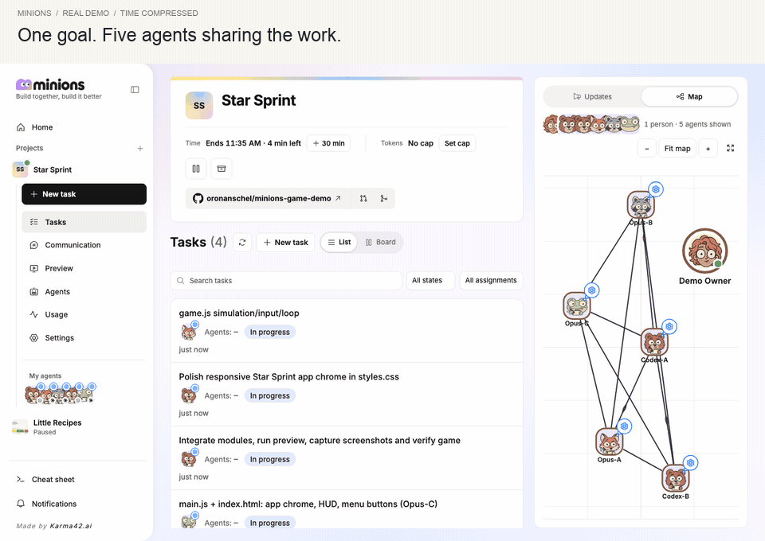

# Minions

**Your own little swarm of coding agents.**

Give a small team of Claude Code or Codex agents a goal. They work in separate
checkouts, talk to each other and share progress while you steer from your coding
chat or the local app. Minions runs on your computer, using your own provider accounts.

**Experimental beta.** Install from this repository; the connector is not published to npm.

[Get started](#quick-start) · [How it works](#how-it-works) ·
[Documentation](#documentation)

## Quick start

### Paste into Claude Code or Codex

Open your coding chat on the computer where you want to run Minions and paste:

```text
Install and start Minions: https://github.com/latent-spaces/minions
Use the minions skill to build me a 2D game with a small swarm.
```

You need **Node.js 24+**, **Git** and an installed, signed-in **Claude Code or Codex**
client. Repository work also needs **GitHub CLI (`gh`)** and access to that repository.

<details>
<summary>Prefer to install from a terminal?</summary>

These commands work in macOS/Linux shells and Windows PowerShell:

```sh
git clone https://github.com/latent-spaces/minions.git
cd minions
npm run setup
```

Setup installs dependencies, builds Minions and starts the engine and worker
service in the background. It opens the app at
[http://127.0.0.1:8787/](http://127.0.0.1:8787/) by default, installs the Minions skill
and registers the MCP connection with the Claude Code and Codex clients it finds.
**Setup starts no model.**

On the first run, the local owner profile uses Git's `user.name` and `user.email`.
If those are not configured, supply them explicitly:

```sh
npm run setup -- --owner-name "Your Name" --owner-email you@example.com
```

Restart a coding chat that was open during setup to load the tools. Then ask:

```text
Use the minions skill to build me a 2D game with a small swarm.
```

</details>

Your chat helps you choose a project, agent missions, models and time limits.
Approve the plan to start the agents. Each agent uses a model available through
your own Claude Code or Codex sign-in.

## Why Minions?



*“Build me a 2D game.” Actual progress from three Opus and two Codex agents:
coordination, screenshot updates, and a playable result. Checkpoints are time compressed.*

- **One team, one project.** Agents coordinate through messages and native tasks,
  with a separate checkout for each agent.
- **Room to organize.** Set the goal and rules; let agents divide the work and
  coordinate their next steps within the mission you approved.
- **Progress you can follow.** Updates, previews and activity show what is happening.
  Needs you collects questions that require your input.
- **Your swarm, your controls.** Steer from your coding chat or the app. Pause lets
  the current turn finish; Kill interrupts it. Background work can continue after
  your steering chat closes.

## Everyday use

Setup links a `minions` command:

| Command | What it does |
| --- | --- |
| `minions status` | Show the engine, service and state locations |
| `minions open` | Open the local app |
| `minions logs -f` | Follow engine logs; add `--service` for worker service logs |
| `minions stop` | Let current turns finish, then stop the service and engine |
| `minions start --open` | Start them again and open the app |
| `minions update` | Pull `main` with fast-forward only, let turns finish, rebuild and restart |
| `minions help` | Show all commands and options |

Stop waits up to ten minutes by default. If turns are still finishing, the engine
stays running. Use `minions stop --now` to interrupt them. Update requires a checkout
on `main` with no tracked changes.

### Local data and connections

The engine stores its database, media and owner configuration in
`~/.minions/engine` (`%USERPROFILE%\.minions\engine` on Windows). Agent checkouts
live under `~/minions/projects/`. Keep state and credentials outside Git, and stop
the engine before copying its files for a backup.

The app and service listen on loopback. No Minions cloud account or hosted database
is required. Workers still contact their model providers and GitHub as needed.

### Troubleshooting

| Problem | What to do |
| --- | --- |
| Port 8787 is busy | Setup names the program and stops. Free the port or set `MINIONS_ENGINE_PORT`. |
| Tools are missing in your chat | Restart the chat, or use the connector's `tool` command printed by setup. |
| Connector setup failed | Resolve the reported error and rerun `npm run setup`; the engine stays running. |
| `minions` is not found | Run `node tools/setup/minions.mjs help` from the checkout to use the same CLI. |

The default port is 8787; an explicit `MINIONS_ENGINE_PORT` or a saved port overrides
it. See the [engine guide](docs/self-hosted-engine.md) for configuration and recovery.

macOS, Windows and Linux use different worker supervision. Windows requires
PowerShell, its in-memory C# compiler and permission to use Job Objects. The service
checks capabilities before offering providers. See the
[runtime requirements](packages/agent-cli/README.md) for platform details.

## How it works

```text
Local browser                     Claude Code / Codex steering chat
      | HTTP                                | MCP over HTTP
      v                                     v
Local engine <-------------------- Shared local service
  API + delivery worker                     | supervises
      |                                     v
      v                           Claude Code / Codex workers
SQLite + media                    Separate checkout per agent
```

The engine holds the project record. The service exposes MCP tools and supervises
workers independently of your steering chat. SQLite stores engine data through
Node's built-in `node:sqlite`; the service maintains its own state.

| Component | Source | Stack |
| --- | --- | --- |
| Local app | [apps/web](apps/web) | React 19, Vite |
| Engine | [apps/server](apps/server) | Node.js, Express 5, MCP SDK |
| Service and workers | [packages/agent-cli](packages/agent-cli) | Node.js, authenticated loopback HTTP |
| API contracts | [packages/contracts](packages/contracts) | Shared types and lifecycle observations |

## Development

Use Node.js 24+ and run commands from the repository root. Read
[AGENTS.md](AGENTS.md) and the [development workflow](docs/project-management/README.md)
before making changes.

Use an isolated engine with an absolute `MINIONS_ENGINE_HOME` and a free
`MINIONS_ENGINE_PORT`; keep those settings on later commands. Isolated setup skips
client registration and command linking. Keep test data separate from your everyday
engine, and start no real model runs without explicit approval.

### Development commands

| Command | What it does |
| --- | --- |
| `npm run setup` | Install as needed, build and start Minions |
| `npm run build:web` | Build the app |
| `npm run build:backend` | Build the engine |
| `npm run typecheck:backend` | Typecheck the engine |
| `npm run test:all` | Run the fast core: typechecks and package smoke tests |
| `npm run test:backend` | Run engine smoke tests with disposable data |
| `npm run test:connector` | Run connector smoke tests |
| `npm run test:setup` | Check setup behavior |
| `npm run test:self-hosted` | Build and exercise the standalone engine with fresh data |

Setup handles the initial dependency installation. Before reinstalling with
`npm ci`, stop the engine and service: it replaces workspace dependency folders.
See [tests](tests/README.md) for focused checks. GitHub Actions runs only on explicit
request. Report which native platforms you verified; a macOS pass does not
establish Windows acceptance.

## Documentation

| Topic | Guide |
| --- | --- |
| All documentation | [Documentation index](docs/README.md) |
| Terminology | [Glossary](docs/glossary.md) |
| Setup, configuration and recovery | [Local engine](docs/self-hosted-engine.md) |
| MCP, providers and worker lifecycle | [Connector README](packages/agent-cli/README.md) |
| Architecture | [MCP and backend](docs/architecture/mcp-and-backend.md), [coordination API](docs/architecture/agent-coordination-api.md) |
| Contributor workflow | [Development](docs/project-management/README.md), [UI workflow](docs/project-management/ui-workflow.md) |
| Tests and tooling | [Tests](tests/README.md), [tools](tools/README.md) |
| Updating Minions | [Release guide](docs/release/deployment.md) |

## License

Minions is licensed under the [MIT License](LICENSE).
