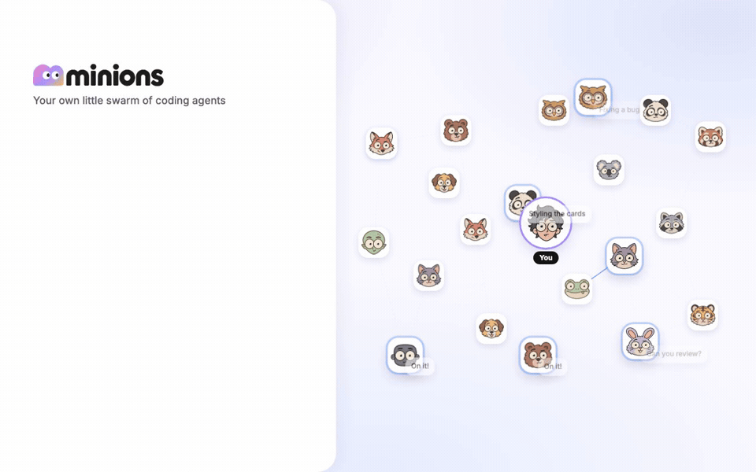

# Minions

**A local team of coding agents, guided from the chat you already use.**



*The app's welcome tour uses illustrative agent activity; no models were run for this recording.*

Give a project a goal, add Claude Code or Codex agents, and let them work in the
background in separate checkouts. Agents coordinate through messages, tasks and
updates. You follow their progress, answer questions and steer the work from your
coding chat or the local web app.

Minions runs on your computer: a local engine, a shared worker service and a SQLite
database. No Minions cloud account or hosted database is required. Model execution
uses your own Claude Code or Codex account.

**Status:** experimental beta, distributed from this repository. The connector is
not published to npm. No open-source license has been selected; see [License](#license).

[Quick start](#quick-start) · [Everyday use](#everyday-use) ·
[Development](#development) · [Documentation](#documentation) ·
[Contributing](#contributing)

## What you can do

- **Give agents a shared goal.** A Project Card records the name, description and
  rules they work within.
- **Run a small team in parallel.** Each background agent works in its own checkout
  and can continue after your steering chat closes.
- **Keep work visible.** Native tasks, project messages, an updates feed and project
  previews help you follow progress without reading every agent conversation.
- **Steer from Claude Code or Codex.** An MCP connection exposes project and agent
  tools to your coding chat. The local web app shows the same projects.
- **Control execution.** Approve an agent's mission, provider and lifetime before
  work starts. Pause lets its current turn finish; Kill interrupts it. Needs you
  collects questions that require your input.

For the product principles and intended direction, read [VISION.md](VISION.md).

## Quick start

### Prerequisites

- **Node.js 24 or newer**, with npm.
- **Git**, with `user.name` and `user.email` configured for the first setup.
- **Claude Code or Codex**, installed and signed in on this computer. Use a current
  client with MCP dynamic header-helper support.
- **GitHub CLI (`gh`) and repository access** for the projects your agents will
  work on. Setup guides you through GitHub CLI sign-in when needed.

macOS, Windows and Linux have platform-specific worker supervision. Windows workers
require Windows PowerShell and its in-memory C# compiler, plus permission to create
and assign Job Objects. The service checks these capabilities before offering
providers. See the [runtime requirements](packages/agent-cli/README.md) for details;
configuration checks alone do not establish native worker readiness.

### Install and start

Run in a terminal on the computer that will run the agents. These commands work in
macOS/Linux shells and Windows PowerShell:

```sh
git clone https://github.com/latent-spaces/minions.git
cd minions
npm run setup
```

Setup installs dependencies, builds the application, initializes local state and
starts the engine and shared service in the background. It opens the local app at
[http://127.0.0.1:8787/](http://127.0.0.1:8787/) by default, installs the Minions skill
and registers one `minions` MCP connection with the Claude Code and Codex clients it
finds. **Setup starts no model.**

The browser opens as this engine's owner without a sign-in step. Setup uses your
Git name and email for that profile on the first run. To supply them explicitly:

```sh
npm run setup -- --owner-name "Your Name" --owner-email you@example.com
```

Restart any coding chat that was open during setup so it loads the Minions tools.
Then ask, for example:

```text
Use the minions skill. Create a private Minions project for this repository
and help me choose missions, models and time limits for three agents.
```

Approve the proposed work to start the agents. Each agent uses a model available
through your own provider sign-in; you can choose a model per agent.

### If setup needs attention

| Symptom | Next step |
| --- | --- |
| Port 8787 is occupied | Setup names the program and stops. Free the port or choose `MINIONS_ENGINE_PORT`; setup does not stop another program. |
| Tools are missing in an existing chat | Restart the chat. Until then, use the connector's `tool` command printed by setup. |
| The connector failed after the app opened | The engine stays running. Resolve the reported error and rerun `npm run setup`. |
| `minions` is not on PATH | Setup reports a failed command link. From this checkout, use `node tools/setup/minions.mjs help` for the same CLI. |

A saved port or explicit `MINIONS_ENGINE_PORT` overrides the default address. For
configuration, file locations, backups and recovery, see the
[local engine guide](docs/self-hosted-engine.md) and
[connector README](packages/agent-cli/README.md).

## Everyday use

Setup links a `minions` command for managing the installation:

| Command | Purpose |
| --- | --- |
| `minions status` | Inspect the engine, shared service and state locations |
| `minions open` | Open the local app |
| `minions logs -f` | Follow the engine log; add `--service` for the worker service |
| `minions stop` | Let current turns finish, then stop the service and engine |
| `minions start --open` | Start them again and open the app |
| `minions update` | Fast-forward the checkout from `main`, let turns finish, rebuild and restart |
| `minions help` | Show commands and options |

Stopping waits up to ten minutes by default. If turns are still finishing, the
engine stays running. `minions stop --now` interrupts current turns.

The engine stores its database, media and owner configuration under
`~/.minions/engine` (`%USERPROFILE%\.minions\engine` on Windows). Agent checkouts
live under `~/minions/projects/`. Keep private engine state and credentials outside
Git; stop the engine before copying its files for a backup.

`minions update` requires the checkout to be on `main` with no tracked changes.

Minions listens on loopback. Coding agents still contact their model providers and
GitHub as needed; local storage does not make model execution offline.

## How it works

```text
Local browser                     Claude Code / Codex steering chat
      | HTTP                                | MCP over HTTP
      v                                     v
Local engine <-------------------- Shared local service
  API + delivery worker                     | supervises
      |                                     v
      v                           Claude Code / Codex workers
SQLite + media                    Separate checkout per agent
```

The engine owns the shared project record: projects, agents, messages, tasks and
updates. The service exposes MCP tools and supervises background workers independently
of your steering chat. Pause waits for the current turn to finish before preventing
new turns; Kill interrupts the worker's process tree.

| Component | Location and stack |
| --- | --- |
| Web app | [`apps/web`](apps/web) — React 19 and Vite |
| Engine | [`apps/server`](apps/server) — Node.js, Express 5 and MCP SDK |
| Persistence | SQLite through `node:sqlite`, plus local media files |
| Worker service | [`packages/agent-cli`](packages/agent-cli) — Node.js and authenticated loopback HTTP |
| Shared contracts | [`packages/contracts`](packages/contracts) — API shapes and lifecycle observations |

Workers use POSIX process groups on macOS/Linux and Job Objects on Windows. Runtime
capabilities, lifecycle and recovery are documented in the
[connector README](packages/agent-cli/README.md).

## Development

Read [AGENTS.md](AGENTS.md), [VISION.md](VISION.md) and the
[shared development workflow](docs/project-management/README.md) before changing
product behavior. Reuse the existing checkout and preserve concurrent work.

Run commands from the repository root with Node.js 24+. `npm run setup` handles the
initial dependency installation. If you need to reinstall with `npm ci`, stop the
engine and worker service first: it replaces workspace dependency folders.

For application development, use an isolated engine with an absolute
`MINIONS_ENGINE_HOME` and a free `MINIONS_ENGINE_PORT`. Keep those settings on later
commands. Isolated setup skips automatic client registration and command linking.
Do not use your everyday engine's data for tests or start real model runs without
explicit approval. See the [local UI workflow](docs/project-management/ui-workflow.md).

### Development commands

| Command | Purpose |
| --- | --- |
| `npm run setup` | Install as needed, build and start the local application |
| `npm run build:web` | Build the web app |
| `npm run build:backend` | Build the engine |
| `npm run typecheck:backend` | Typecheck the engine |
| `npm run test:all` | Run the fast core: typechecks and package smoke tests |
| `npm run test:backend` | Run engine smoke tests with disposable data |
| `npm run test:connector` | Run connector smoke tests |
| `npm run test:setup` | Check setup behavior |
| `npm run test:self-hosted` | Build and exercise the standalone engine with fresh data |

The core suite uses isolated state and does not require model execution. See
[tests](tests/README.md) for scope and focused checks. GitHub Actions runs only on
explicit request; ordinary changes use local validation. Report which native
platforms you verified; a macOS pass does not establish Windows acceptance.

### Repository map

```text
apps/web/             Local web app; shared presentation in src/ui/
apps/server/          Engine API, delivery worker and domain modules
packages/agent-cli/   Shared service, worker runtime and bundled Minions skill
packages/contracts/   Shared API contracts
tools/setup/          Setup and everyday CLI
tools/benchmarks/     Synthetic capacity and storage studies
tests/                Cross-component smoke tests and test support
docs/                 Architecture, decisions, design and workflow
```

## Contributing

Keep changes focused on a concrete participant need and the principles in
[VISION.md](VISION.md). Discuss changes to product behavior or authority with the
owner before implementing a dependent choice. The
[decision log](docs/decisions.md) records selected policies.

Before submitting a pull request:

1. Read the relevant component documentation and current implementation.
2. Make a cohesive change and remove superseded implementation in the same change.
3. Run focused local checks. For UI changes, verify the actual local application.
4. Describe the problem, resulting behavior, validation and any remaining acceptance
   in the PR. Include reproduction steps for fixes and screenshots for visual changes.

Keep credentials, private engine records and personal data out of commits, screenshots
and logs shared for review. The repository does not currently define a separate
security-reporting or support channel.

## Documentation

| Topic | Reference |
| --- | --- |
| Documentation overview | [Documentation index](docs/README.md) |
| Product direction | [Vision](VISION.md) and [owner decisions](docs/decisions.md) |
| Terminology | [Glossary](docs/glossary.md) |
| Engine setup and operation | [Local engine guide](docs/self-hosted-engine.md) |
| MCP, providers and worker lifecycle | [Connector README](packages/agent-cli/README.md) |
| Architecture and coordination | [MCP and backend](docs/architecture/mcp-and-backend.md), [agent coordination API](docs/architecture/agent-coordination-api.md) |
| Contributor workflow | [Development workflow](docs/project-management/README.md), [UI workflow](docs/project-management/ui-workflow.md) |
| Updating computers and release history | [Release guide](docs/release/deployment.md) |

## Current work

The remaining items from the repository's work list are:

- [ ] Develop Minions in Minions: isolated agent clones and live previews, with PRs
      reviewed and merged by the owner.
- [ ] Put the recommended option first in Needs you questions and mark it
      “(recommended)”.
- [ ] Give the `experiment-waves/` runbook and tools a repository home.

## Name and history

Minions is small on purpose: a handful of agents working together on your computer.
It was previously MyLittleSwarm, and Karma42 before 10 November 2026. This repository
is `latent-spaces/minions`; earlier history lives in the private `karma42-swarm`
repository. It does not deploy to or connect to `karma42.ai`.

## License

No license file is included in this repository. An open-source license and its
permissions have not been established. The connector package is private and is not
published to npm.
