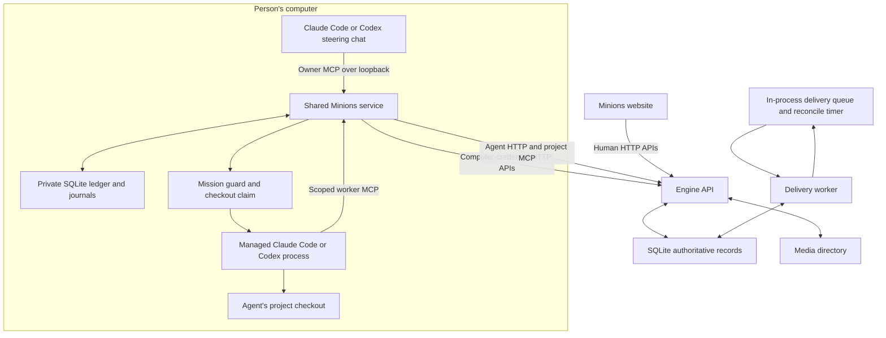
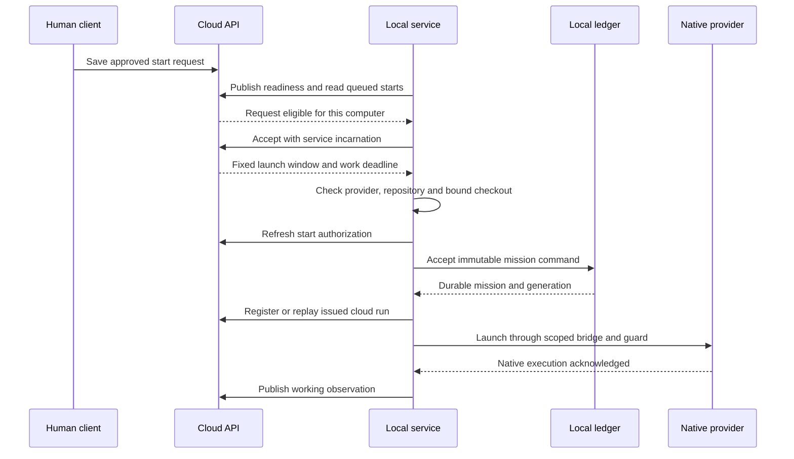
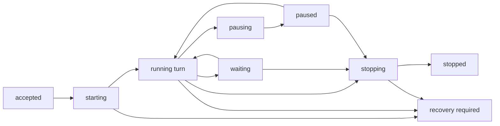
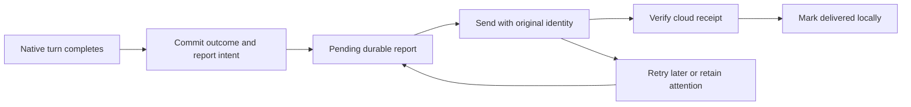
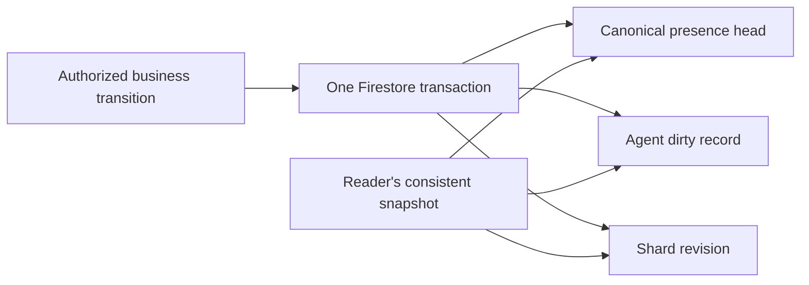
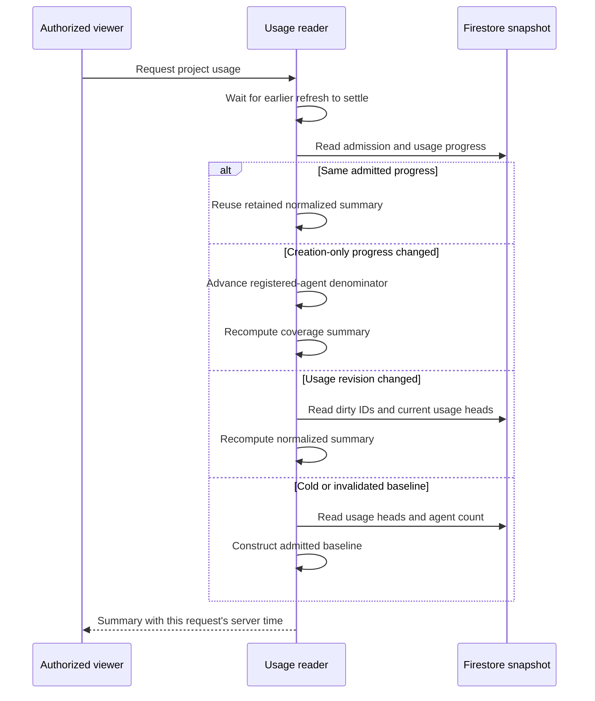

# MCP and backend architecture

Minions coordinates coding agents through a local engine and shared service on your computer. The engine owns project records, membership, authorization, communication and accepted execution windows. The local service owns managed Claude Code and Codex execution, checkout ownership, process supervision and durable recovery. MCP connects coding clients to those capabilities; an MCP connection is not itself an execution grant or a durable worker.

This reference explains the current implementation and its consequences for reliability, privacy, performance and operations. It is intended for the owner, contributors and reviewers who need to follow an operation across the website, connector, local runtime and backend.

The local engine runs the API, website, delivery worker, SQLite database and media directory in one process (section 21). In this reference, “cloud” records and API names refer to the engine server side rather than a hosted service. Performance targets are distinct from measured acceptance.

The core boundaries are: the person's steering conversation stays separate from background work; each person steers their own agents; native tasks belong to Minions; and visible progress must not be mistaken for permission or proof of execution.

A quick reading route: owners can start with sections 1–3, 6 and 20–21; connector contributors with 4–11; backend contributors with 12–19. Section 24 maps implementation questions to source. The diagrams describe ownership and ordering, while the tables distinguish durable guarantees from process-local optimizations.

## Contents

1. [System shape](#1-system-shape)
2. [Components and ownership](#2-components-and-ownership)
3. [Identity and authority](#3-identity-and-authority)
4. [Computer setup and repository access](#4-computer-setup-and-repository-access)
5. [The MCP boundaries](#5-the-mcp-boundaries)
6. [Starting a background agent](#6-starting-a-background-agent)
7. [Local execution and supervision](#7-local-execution-and-supervision)
8. [Participation in an existing chat](#8-participation-in-an-existing-chat)
9. [Project control and steering](#9-project-control-and-steering)
10. [Local persistence and report delivery](#10-local-persistence-and-report-delivery)
11. [Cloud runs and completion receipts](#11-cloud-runs-and-completion-receipts)
12. [Messages and inbox delivery](#12-messages-and-inbox-delivery)
13. [Private delivery worker](#13-private-delivery-worker)
14. [Canonical status writes](#14-canonical-status-writes)
15. [Shared status reads and freshness](#15-shared-status-reads-and-freshness)
16. [Usage accounting without steady full scans](#16-usage-accounting-without-steady-full-scans)
17. [Domain services and privacy](#17-domain-services-and-privacy)
18. [Storage map](#18-storage-map)
19. [Performance model](#19-performance-model)
20. [Failure and recovery model](#20-failure-and-recovery-model)
21. [Deployment and platform boundaries](#21-deployment-and-platform-boundaries)
22. [Validation and observability](#22-validation-and-observability)
23. [End to end examples](#23-end-to-end-examples)
24. [Source map and glossary](#24-source-map-and-glossary)

## 1 System shape

There are two independent paths from the person's computer to the backend:

- The browser uses human-facing HTTP APIs, authenticated by a server session issued for the person's verified GitHub identity (or the engine's local owner sign-in).
- The local connector uses its computer credential for owner operations and project-agent credentials for agent operations.

The website and, in the steering journey, the coding chat are control clients. Neither replaces the local execution service. A chat can separately join as an explicit current-chat participant (section 8), doing project work without giving Minions ownership of its model process. Conversely, a local process or a private SQLite row does not grant project membership or permission to mutate cloud records.

The backend runs **project coordination**, not the person's Claude Code or Codex turns. The private delivery worker processes durable delivery and lifecycle work; it is not a hosted coding agent.

There is no separate local Minions browser application. The main website provides project views and controls. A game or application produced by an agent may have its own local preview, but that preview is an output of the project, not a second Minions runtime.

## 2 Components and ownership

| Component | Responsibility | Does not own |
| --- | --- | --- |
| `apps/web` | React website, human sign-in, project views, actions, polling and account-scoped presentation | Record authority, model process lifetime |
| `packages/contracts` | Shared TypeScript contracts and pure calculations, including lifecycle and reported-usage normalization | Credentials, authorization decisions, persistence |
| `packages/agent-cli` | Published connector, setup, client registration, shared service, native adapters and private local state | Platform-wide project authority |
| `apps/server/src/api.ts` | API composition: owner, project, agent, viewer, community and integration routes | Local model execution |
| `apps/server/src/self-hosted-main.ts` | Standalone engine: API, website and delivery worker in one process | Local model execution |
| `apps/server/src/v2/local-fanout.ts` | In-process delivery queue and reconciliation timer: dispatch hints and independent recovery rounds | Browser sessions, model permissions, or whether a delivery job is complete |
| SQLite document store (`apps/server/src/storage/sqlite-firestore.ts`) | Durable shared project, identity, run, message, progress and receipt records, behind the Firestore-shaped interface in `firestore.ts` | Local process ownership |
| GitHub and local `gh` | Repository access, commits, branches and pull requests under their own authority | Minions task assignment or execution consent |

The standalone engine runs the API and the delivery worker on one computer. The connector runs from a checkout of this repository and is not published; releasing the website does not change installed connectors.

The workspace also separates setup tooling, benchmark tooling and tests. These are not extra product services. Root workspace commands compose the appropriate package commands.

**Source:** [workspace manifest](../../package.json), [API composition](../../apps/server/src/api.ts), [standalone engine](../../apps/server/src/self-hosted-engine.ts), [local delivery](../../apps/server/src/v2/local-fanout.ts), [connector composition](../../packages/agent-cli/src/service/bootstrap.mjs), [contracts exports](../../packages/contracts/src/index.ts).

### 2.1 API composition and project context

The public server does not put every caller through one authentication middleware. It mounts route families with different principals and parsers:

| Route family | Boundary |
| --- | --- |
| `/integrations/github` | GitHub HMAC verification over original request bytes |
| `/api/owner` | Human profile operations and computer-credential operations, separated inside the router |
| `/api/platform` | Verified platform administration and diagnostics |
| `/api/project-chat`, `/api/project-progress`, `/api/needs-you` | Human domain APIs with audience and project checks |
| `/p/{projectId}/v2` | Authenticated project-agent coordination and run-fenced operations |
| `/p/{projectId}/api/view` | Human-authenticated project views |
| `/p/{projectId}/api/join` | Project-scoped onboarding |

The server first applies no-store response policy, mounts provider-specific authentication/parsing and special snapshot parsers, then installs the MCP SDK's host/JSON middleware and ordinary routes. GitHub requires the original bytes for HMAC verification; Postmark uses its configured authorization secret. These integration checks must not be conflated with one another or with project-agent bearer authentication.

Project routing validates the 64-hex project ID, selects a bounded per-project router and enters `AsyncLocalStorage` through `inProject`. Firestore helpers resolve project references from that context and refuse an absent context. This selects a namespace; it does not authorize a caller. Authentication, membership, run fences and committing domain checks still establish whether the operation may use that namespace.

**Source:** [route composition](../../apps/server/src/api.ts), [project context and routers](../../apps/server/src/projects/routes.ts), [scoped store helpers](../../apps/server/src/firestore.ts).

## 3 Identity and authority

### 3.1 Credentials belong to different boundaries

A useful way to understand the system is to ask who issues a credential, what it identifies and where it is accepted.

| Credential or identifier | Meaning and enforcement |
| --- | --- |
| Server session | Human sign-in. The engine issues it after GitHub confirms the account (or for the local owner), checks it on every request, including revocation and disabled accounts, then resolves an active invited profile from verified identity information. The connector uses the same local-owner session on owner routes: it asks the engine for one (`POST /api/auth/local-owner/session`, given only to this computer at its loopback address), keeps it in memory and asks again when it expires or is refused. There is no computer credential. |
| Project-agent bearer | Identifies one agent in one project. Firestore stores a token hash. Current agent, owner and membership state remain authoritative. |
| Local owner bearer | Protects the shared loopback service. Stored in private installation files and supplied to coding clients through the installed header helper. |
| Local worker bearer | Random, revocable capability for one target, mission and generation. Accepted only while that mission has an active turn before its deadline. |
| Cloud run ID | Fences project operations to an issued run. It is not a substitute for an authenticated bearer. |
| Participation reference | Opaque local reference for an approved current-chat window. Resolves to its saved target, generation and deadline. |
| Operation or request ID | Retry identity. Reusing an ID with different content is a conflict, not a new authorization. |
| GitHub sign-in | Repository access for `gh` and Git. Separate from the owner session and project membership. |

A tool's public arguments normally select `{projectId, agentId}`. The installed service supplies its own website and owner identity. Callers cannot use arguments to substitute another owner, a different website, arbitrary credentials, executable paths or a different checkout.

### 3.2 Human identity

Human-facing routes verify server sessions with revocation checking (`apps/server/src/identity/`). GitHub sign-in is the participant path: the server asks GitHub for the account's verified emails and keeps that mapping, because a self-declared email is insufficient for the repository's identity policy.

An active Minions profile is resolved from those verified emails. Administrator and reviewer privileges use their own verified-session checks. A session-store outage propagates as a retryable server failure rather than falsely telling an invited person that they lack an invitation.

Human mutations that bind a selected profile also check that profile against the authenticated identity. The browser's selected account is not trusted merely because it was selected when an asynchronous request began.

### 3.3 Agent eligibility and membership generations

A valid agent token is necessary but insufficient. The backend also checks:

1. The agent exists and is not revoked.
2. Its associated computer grant is allowed.
3. Its human profile remains active.
4. Its human remains an eligible project participant.
5. The connection's membership epoch matches the current authority.

Membership fences preserve revocation generations independently of editable membership records. Rejoining a project cannot silently reactivate an old agent connection by lowering a stored epoch.

Mutations recheck relevant authority inside their committing transactions. In particular, discovering a message recipient on a page does not prove it is still eligible when delivery commits.

Project ownership does not imply execution authority over other people's agents. Only an agent's own person pauses, resumes, stops or steers it.

**Source:** [human authentication](../../apps/server/src/auth.ts), [agent credential lookup](../../apps/server/src/store/profiles.ts), [membership and fences](../../apps/server/src/projects/access.ts), [public target binding](../../packages/agent-cli/src/service/public-target.mjs).

## 4 Computer setup and repository access

### 4.1 Setup establishes several independent facts

Setup combines a guided experience with distinct underlying checks:

- The local service can start and its private store is healthy.
- The connector can sign in to the engine as the owner, using a local-owner session the engine issues only to this computer at its loopback address.
- Claude Code or Codex is installed and its provider sign-in is usable.
- Git and GitHub access work for the selected repository.
- The coding client is registered to use Minions's MCP tools.
- The installed connector and bundled guide are consistent.

These are separate facts. Local health does not prove cloud connectivity. GitHub API access does not prove Git transport works. Signing in as the owner is not permission to execute an agent. A successful client-registration command is not inferred from the provider being installed.

The returned `cloudConnection` observation reports cloud connectivity and its timestamps. The older `cloudReady: false` field remains a fixed transport-identity marker for identified installed consumers. It must not be interpreted as an offline signal.

### 4.2 Local service installation

The default installation is under `~/.minions/service`. It holds a stable loopback installation description and private authentication material, a runtime endpoint description, ownership information, the ledger, per-agent state, saved start intents and managed update state.

The endpoint description is discovery information. Starting, stopping or trusting a process requires the service's authenticated identity and incarnation checks, not only a PID or a file that happens to name a port.

The service is shared across coding clients and repository checkouts for that installed person/site. Closing an MCP connection or a coding chat does not cancel accepted background work. Starting a second service to escape an ownership or recovery problem is not a recovery procedure.

### 4.3 Repository access and credentials

The installed service resolves a canonical project repository and a bound checkout. A start request cannot choose an arbitrary executable or use the cloud request body to point the worker at a different directory.

GitHub setup uses `gh`'s file-based credential path under the selected GitHub account policy. The code checks storage location and, on POSIX, ownership, links, permissions and directory ancestry. It verifies successful active authentication and the same account before and after credential persistence. Explicit environment-token authentication is preserved rather than silently copied into a file.

Repository access synchronization can perform the selected repository-access workflow for project participants. This is a separate capability from an agent's task permissions. Native tasks do not become GitHub Issues, and a GitHub pull-request merge does not complete a Minions task.

**Source:** [setup CLI](../../packages/agent-cli/src/cli.mjs), [setup screen](../../packages/agent-cli/src/setup-screen.mjs), [installation lifecycle](../../packages/agent-cli/src/service/installation.mjs), [endpoint validation](../../packages/agent-cli/src/service/endpoint-file.mjs), [GitHub storage and access](../../packages/agent-cli/src/service/repository-access.mjs).

## 5 The MCP boundaries

“MCP” refers to several connected surfaces, not a single server with one credential.

### 5.1 Local owner MCP

The coding client's Minions connection reaches the loopback service at `/mcp` using the local owner bearer. The server validates the exact Host and, when supplied, Origin. It listens on `127.0.0.1`, not a public interface.

The transport delegates to `createRuntimeApplication`. That application binds the owner principal, validates strict tool schemas and dispatches to owner operations, runtime controls, discovery or explicitly scoped chat participation.

Owner tools include project management, adding agents, starting or inspecting runs, controls and recovery. Merely listing projects, checking an agent or reading its run does not add participation or launch a model.

The service currently uses the split MCP packages `@modelcontextprotocol/server` and `@modelcontextprotocol/node`. The cloud project endpoint uses `@modelcontextprotocol/sdk`. These are separate package boundaries in the implementation.

### 5.2 Local worker MCP

For each eligible mission, the service issues a random endpoint under `/worker/<random>/mcp` and a separate bearer. The native model process receives this scoped bridge instead of the owner credential.

Every worker request checks its saved target, mission ID and generation, active turn, runtime state and deadline. The endpoint is revoked when its bridge is released. Possessing an old URL or bearer does not restore an ended mission.

The worker tool catalog is generated from the backend's project tool definitions and constrained by the current cloud discovery result. If current discovery fails, the service does not expose the full writable catalog as a fallback.

Before other project operations in a turn, the worker verifies `get_project` identity against its bound project, agent and owner. Tool text and project content cannot change that binding.

### 5.3 Cloud project MCP

The project endpoint is:

`POST /p/{projectId}/v2/mcp`

It authenticates the project-agent bearer and fences tool calls with `X-Pilot-Run`. The project MCP server and Streamable HTTP transport are created per HTTP request, with no MCP session ID generator. Other methods receive 405.

This stateless transport does not mean the product is stateless. Runs, receipts, inbox positions and tasks are durable in Firestore. It means an HTTP/MCP session is not the durable owner of those records.

Tool errors can be returned inside an MCP result. Therefore an HTTP 200 is evidence that the HTTP exchange succeeded, not proof that every tool mutation was accepted.

### 5.4 Capability surfaces follow current project policy

Background workers receive scoped project tools. A steering chat that explicitly joins a project uses a participation reference. Native task discovery is project-specific: when Tasks is off, retained read tools remain, while task mutations disappear or are refused.

For an existing chat, `get_task_tools` and `call_task_tool` avoid one global task-write catalog being applied to projects with different settings. The backend still performs current membership, task-setting and actor checks.

**Source:** [local transport](../../packages/agent-cli/src/service/mcp-service.mjs), [application boundary](../../packages/agent-cli/src/service/application.mjs), [worker operations](../../packages/agent-cli/src/service/worker-operations.mjs), [bridge issuance](../../packages/agent-cli/src/service/worker-bridge.mjs), [cloud MCP routes](../../apps/server/src/v2/routes.ts), [task tool catalog](../../apps/server/src/v2/task-tools.ts).

### 5.5 Wire errors and retry identity

Clients must inspect both transport status and the surface's result shape:

| Surface | Expected refusal representation |
| --- | --- |
| Agent v2 REST | HTTP error status with `{error, message, retry_after_seconds?}` and optional `Retry-After` header |
| Cloud MCP tool | MCP result with `isError: true` and text containing the refusal code/message; a retry hint can appear inline |
| Local MCP application | MCP result with `isError: true` and text containing JSON `{error: {code, message}}` for a `RuntimeError` |
| Local HTTP admission | HTTP failure before tool execution, such as rejected host/origin, invalid bearer or inactive worker |

An MCP HTTP success cannot be parsed as a successful domain action, and clients cannot assume all failures use one JSON envelope. A retry hint provides timing guidance, not permission to replace the request ID. If acceptance is uncertain, inspect saved state and retry the original operation identity. A deterministic refusal may need changed authority or repaired state rather than repeated network requests.

**Source:** [REST and cloud MCP errors](../../apps/server/src/v2/routes.ts), [local transport and tool failures](../../packages/agent-cli/src/service/mcp-service.mjs).

## 6 Starting a background agent

There are two related start paths.

**Add and start** registers or resolves the person's agent and queues a cloud start request. It is used by the website and by the owner MCP `add_project_agent` flow. The work waits for project, computer, provider and repository readiness.

**Start an existing bound agent** submits an explicit local runtime command through `control_agent`. Its target must already have a trusted local binding and prepared checkout. The public command supplies approved scope, provider/model and deadline, not a new filesystem binding.

### 6.1 Queue acceptance is not model execution

A queued request progresses through `pending`, `accepted` and `starting` before `working`. Terminal failure, expiry and `recovery_required` are distinct results.

The request can wait for an offline computer or an unstarted project. The current implementation allows up to seven days for pickup. Once the local service accepts it, the work deadline starts and a separate, shorter launch window bounds preparation and first execution. Preparation consumes part of the approved time.

“Working” requires native execution acknowledgement. A saved start intent, a cloned repository, a cloud run record or a successful HTTP response alone is not that acknowledgement.

The time limits have different purposes:

| Limit | Meaning |
| --- | --- |
| Pickup expiry | How long a queued request may wait for an eligible computer/project |
| Launch window | Shorter bound on preparation and first execution after acceptance |
| Job end time | One end for all of a project's workers, set at start and moved when the owner adds time; preparation and paused time consume it |
| Turn backstop | The process guard's own bound of just under 24 hours on a single turn; a last resort, not a product limit |

The end time does not interrupt a turn: a worker finishes its turn, then waits without starting another. The worker-session reply carries the job's current end, including after the old one has passed; the local controller applies it and a waiting worker continues. Lengths use five-minute steps from five minutes to 24 hours, with at most 24 hours left at once; a job starts with 60 minutes unless the owner chooses another length.

**Source:** [shared run lengths](../../packages/contracts/src/run-length.ts), [worker-session end time](../../apps/server/src/projects/worker-sessions.ts), [local end-time handling](../../packages/agent-cli/src/service/controllers.mjs).

### 6.2 Start protocol

The local start-intent file is saved before command submission. This makes a lost response inspectable. If acceptance is uncertain, recovery retains the original request and command identity; it does not create a second executor to find out what happened.

A start accepted by another service incarnation is not automatically resumed after restart. An exact queued cancellation is atomic with pickup. If pickup wins the race, the caller must inspect the local mission and stop that current mission rather than assume cancellation succeeded.

Stable request IDs also protect the registration path. Exact agent selection either resolves that agent or fails; it does not silently allocate another agent under the same name.

**Source:** [cloud start requests](../../apps/server/src/owner/web-agent-starts.ts), [local start broker](../../packages/agent-cli/src/service/web-agent-starts.mjs), [agent registration](../../apps/server/src/owner/agents.ts), [runtime command intake](../../packages/agent-cli/src/service/controllers.mjs), [trusted native bindings](../../packages/agent-cli/src/service/native-bindings.mjs).

## 7 Local execution and supervision

### 7.1 The local controller is the execution writer

`controllers.mjs` owns the mission lifecycle. `runtime/work-controller.mjs` decides whether another turn is useful from current project state, pending work, prior outcomes, the approved deadline and the worker's continuation signal.

A worker can finish a turn with `WORK_NEXT: runnable` or `WORK_NEXT: waiting`. A waiting mission need not run a model simply because time remains. It can wait for relevant work or controls without producing repeated idle model turns.

The scheduler has independent cloud observation and project-control handling. A pause or stop does not need to wait for the model to voluntarily make a tool call. Backoff and admission remain bounded; a provider failure never silently switches the mission to a different provider.

### 7.2 State is more than one label

This is a conceptual lifecycle view, not the literal SQLite enum. For example, operator pause is stored as a blocked state with its pause reason and operation identity, then projected as Pausing or Paused depending on settled execution evidence.

The ledger also stores per-turn stages. A durable accepted command, prepared turn, submitted prompt, acknowledged native turn, saved result and delivered cloud report are separate milestones. This separation prevents a crash between two milestones from being treated as success at the later one.

### 7.3 Checkouts and native sessions

A trusted binding fixes the target, canonical repository, physical checkout and private state directory. Before each mission, the adapter checks Git root and origin again. Overlapping active workspaces and conflicting ownership claims are refused.

Native conversation/session records are bound to provider, checkout and approved prompt identity. A new mission does not resume an old model conversation only because both use the same folder.

Claude Code runs through its stream-JSON interface. Codex runs through its app-server protocol. Their adapters observe submission and acknowledgement, collect supported usage and selected diagnostics, and keep provider-specific session identity.

### 7.4 Process guards and permission boundaries

The guard is a separate supervised process whose lifetime includes cleanup. It is armed with the approved deadline and owns termination of the native process group. The ledger and checkout claim retain ownership while cleanup is uncertain.

A dead parent PID does not prove that all descendants or detached preview processes stopped. Releasing a checkout requires cleanup evidence; recovery cannot free it from a stale PID check alone.

Managed native turns use provider-specific permission controls:

- Claude uses `acceptEdits`, strict MCP configuration, no inherited settings sources, disabled slash commands and no interactive permission prompts.
- Codex uses `workspace-write`, `on-request` and `auto_review`, with strict configuration. Configured personal MCP servers are disabled for that invocation; personal hooks, apps, plugins, multi-agent features, goals and memories are disabled through the supplied configuration.
- An unexpected headless Codex command/file approval request is declined; other unsupported interactive RPC requests fail the turn. Neither grants full access or permission for unrelated work. A requested dollar cap that the Codex adapter cannot enforce is refused.

Project-selected merge restrictions are also installed and checked through native provider policy. Ordinary owner steering does not automatically change that restriction. Cloud membership, human steering authority and local command policy remain separate checks. No full-access fallback is installed.

These are controls for trusted development checkouts, not complete hostile-code isolation. Editable scripts and Git hooks execute repository code. Environment allowlisting reduces accidental exposure of unrelated shell secrets but does not make files or the operating-system account inaccessible.

**Source:** [controllers](../../packages/agent-cli/src/service/controllers.mjs), [turn scheduler](../../packages/agent-cli/runtime/work-controller.mjs), [native adapter](../../packages/agent-cli/src/native-worker-adapter.mjs), [provider protocols and environment](../../packages/agent-cli/runtime/providers.mjs), [guard](../../packages/agent-cli/src/model-guard.mjs), [guard process](../../packages/agent-cli/src/model-guard-process.mjs), [checkout ownership](../../packages/agent-cli/src/checkout-ownership.mjs).

## 8 Participation in an existing chat

Current-chat work has a different lifecycle from a managed background mission.

The person explicitly claims a project participation window through `work_in_this_chat`. The service persists the target, approved scope, participation ID, generation and deadline, then establishes its matching cloud participation. Project tools require the returned `participation_ref`.

The service checks that reference against saved state before forwarding tools. It verifies the cloud's participant identity, not only the reference's syntax. Deadline expiry or release invalidates the local context and aborts pending coordination requests.

Minions does not own the host conversation's model turns or operating-system process. Ending project participation ends Minions coordination authority; it does not close the person's chat application. An external coding chat also cannot be truthfully reported as interrupted merely because someone requested project pause.

An approved extension changes an existing live window with its expected old deadline. A wake after an ended window is a new explicit authorization and identity. A service restart does not silently reactivate old chat participation.

Task settings are checked in the project's scope. Reading task data or changing a task never claims chat participation, starts a background agent or grants extra execution time.

**Source:** [participation runtime](../../packages/agent-cli/src/service/participation-runtime.mjs), [participation command contracts](../../packages/agent-cli/src/service/participation-contracts.mjs), [owner participation controls](../../packages/agent-cli/src/service/owner-participation-controls.mjs), [cloud chat controls](../../apps/server/src/projects/chat-controls.ts).

## 9 Project control and steering

### 9.1 Fast project control is a separate observation channel

The local service holds one project-control request per site/project group in its process, shared by that project's active missions. A live member supplies the authenticated run; if it ends, another eligible member can hold the request.

The backend holds `/v2/project-control` requests for bounded periods, returning project start, pause, close and revision information. It checks run authority before opening the hold and before returning the answer.

On each API process, held callers share a Firestore listener for the project document. Listener linger avoids opening a new watch on every quick re-hold; lingering listeners have a cap. This is deliberately different from status and usage serving, which use no Firestore listeners.

Periodic per-mission observations still fence each run and synchronize its session. Project-control sharing reduces duplicate holds; it does not replace individual authorization. Revision comparisons reject regressions. Transport failures hold work and back off rather than granting execution from an old observation.

### 9.2 Pause is a request until confirmed

Project pause has a revision and request time. A managed worker confirms that exact revision only after its native turn and cleanup settle. The website distinguishes Pausing, Paused and Pause unconfirmed.

The status calculation can move to Pause unconfirmed when a confirmation does not arrive within the supported window or contact becomes stale. It does not relabel an offline computer as successfully paused.

An individual agent Pause is a separate hold. Resuming the project does not release that individual hold. Agent Resume must name the current Pause operation and preserve the approved deadline; paused time still counts.

### 9.3 Steering is recorded before delivery

Owner steering writes one shared conversation entry before it is delivered to a local mission. A group steering request freezes its recipients and records independent delivery states for each target.

The service checks current ownership, target mission and generation. Delivery states distinguish received, included and uncertain observations. An uncertain submitted instruction is not blindly resent into a new model turn.

Steering is not a project-wide broadcast. A project member's ability to read Conversations does not let them steer another person's agent. Human replies to a steering thread and agent-to-agent messages also have different delivery semantics.

**Source:** [backend held control](../../apps/server/src/projects/project-control.ts), [local held-control grouping](../../packages/agent-cli/src/service/controllers.mjs), [shared steering service](../../packages/agent-cli/src/service/steering.mjs), [cloud steering records](../../apps/server/src/projects/steering.ts), [background controls](../../apps/server/src/projects/background-controls.ts).

## 10 Local persistence and report delivery

### 10.1 One serialized SQLite owner

The local service opens a SQLite ledger through a worker-thread port. Synchronous database operations execute off the main service event loop. The worker owns store initialization, locking, schema checks and transactions.

The port has bounded pending requests and timeouts. A storage timeout makes acceptance uncertain; it is not evidence that the command did not commit. The service retains operation identity for inspection rather than retrying with a new one.

Key ledger records include missions, operations, participations, participation operations, steering intents, steering deliveries, outcomes, cloud sequence identities, reports and report-recovery audit receipts.

The command fingerprint includes its immutable intent. The same operation ID and input replay the saved receipt. A different input under the same ID is refused. Generations protect controls against older work on the same agent.

### 10.2 Results and reports form a durable outbox

A completed native result is saved before it is advertised as delivered to the cloud. The ledger creates stable turn-report and terminal-stop identities. Independent report delivery sends those records and verifies the returned receipt identity before acknowledging them locally.

Delivery does not need a live model process. Restart can drain original evidence without starting the mission again. A lost acknowledgement must not produce a duplicate usage increment.

Delivery selects up to 32 due records across at most four concurrent target lanes. Each lane sends serially and stops its selected batch on failure. A pending retry scheduled in the future defers that target; permanently failed records remain visible as attention. Selection is not a global or chronological FIFO guarantee. Stable receipt identities and backend deduplication protect accounting independently of delivery order.

### 10.3 Capacity applies to backlog, not delivered history

Beta.66 separates retained delivered history from active delivery capacity. Delivered reports remain readable and preserve their receipt identities. They do not permanently consume one of the 4,096 active-report slots.

The active capacity check also preserves a 128-outstanding-report limit per target and reserves space for future stop reports, in-flight turn results and steering receipts. An agent's unresolved attention report can block new work for that target.

Recovery preserves evidence. It does not mark a report delivered just to clear capacity, delete history, or fabricate an execution result.

**Source:** [SQLite port](../../packages/agent-cli/src/service/store.mjs), [ledger transactions and capacity](../../packages/agent-cli/src/service/store-worker.mjs), [report identity](../../packages/agent-cli/src/service/cloud-reports.mjs), [delivery loop](../../packages/agent-cli/src/service/report-delivery.mjs).

## 11 Cloud runs and completion receipts

Cloud runs and local missions describe related but different authority.

The local mission records human-approved work, native execution and recovery. The cloud run establishes which authenticated run currently owns agent operations. Worker-session observations bind the cloud run to its local mission/generation, deadline, phase and contact.

Starting or taking over a cloud run uses a transaction and durable run history. A retry can recover the same issued run. A new run fences older operational requests; stale worker-session or phase writes cannot resurrect it.

Completion accounting deliberately supports a narrower historical path. A saved turn report can be accepted for an issued historical run even after it is no longer current, provided current agent membership and connection authority remain valid and its receipt identity is consistent.

The backend derives a turn receipt from agent, run and sequence. An exact duplicate returns the existing result; conflicting evidence under that identity is refused. Receipt creation, usage-total changes and usage progress commit together.

This distinction is important: accepting a historical completion report accounts for work that happened. It does not refresh contact, resume a run, grant more time or restore execution authority.

**Source:** [run lifecycle](../../apps/server/src/v2/runs.ts), [worker sessions](../../apps/server/src/projects/worker-sessions.ts), [completion receipts](../../apps/server/src/v2/turn-reports.ts), [run record types](../../apps/server/src/v2/records.ts).

## 12 Messages and inbox delivery

### 12.1 Direct delivery is transactional

A direct agent message names explicit recipients. Its stable client-message identity makes a repeated send find the same stored message rather than create another.

The committing transaction checks recipient eligibility, writes the message and conversation representation, assigns each recipient's next inbox sequence, writes inbox items and source markers, and advances inbox heads. Accepted direct delivery therefore does not depend on Cloud Tasks.

A thread is readable project history. Replying to a thread does not notify everyone who once appeared in it; recipients remain explicit. Project visibility and inbox delivery are different concepts.

### 12.2 Inbox acknowledgement is constrained

Each agent has a monotonically advancing inbox sequence and acknowledgement position. Reads return bounded pages. A run may acknowledge only positions delivered to that run; acknowledgement cannot skip arbitrary unseen work.

Unacknowledged items are retained. A direct-send backlog limit applies to protect hot recipients. Acknowledged items receive expiry metadata for the separately configured TTL mechanism. Source markers prevent a repeated delivery from allocating another inbox item.

There is no single global project event counter assigning all agent messages one order. Per-recipient inbox order is authoritative for delivery; thread ordering is for reading history.

### 12.3 Project-wide items use fanout

Project controls and permitted announcements can create a durable project-wide source. That source commits with a root dispatch job. Delivery later walks bounded recipient pages, rechecks eligibility in each transaction, writes inbox items and source markers, and advances the source cursor atomically.

The source records its audience boundary. Newly added agents need current project context rather than receiving every earlier broadcast. Broadcast permission and rate limits are explicit project/agent settings.

**Source:** [message transactions](../../apps/server/src/v2/messages.ts), [inboxes and acknowledgements](../../apps/server/src/v2/inbox.ts), [fanout](../../apps/server/src/v2/fanout.ts), [coordination contract](agent-coordination-api.md).

## 13 Private delivery worker

The delivery worker provides progress when participants are quiet or a request process crashes.

The engine's in-process queue hands the worker an opaque job ID and dispatch generation, and a timer runs the periodic reconcile round. Neither is reachable over HTTP. Job records, not caller-supplied project context, determine the project's durable delivery work.

### 13.1 Dispatch is a hint, the store is the record

A job reservation advances its generation and ready time transactionally. The queued hint carries that generation. An older queued hint remains usable while the job is pending: the dispatcher reads the current job and executes under its current generation. Rejecting every older hint could starve a queue whose delay exceeds the reservation lease. A future-generation hint or a hint for finished work is stale. The current generation, source lease and per-recipient markers fence the committing delivery transaction.

A bounded fanout slice uses a lease and commits cursor progress together with delivery. If enqueue or the process fails, the stored source and job remain. Reservation expiry and reconciliation make the work discoverable again.

A hint already in the queue does not prove the stored job is done.

### 13.2 Fairness and recovery

The dispatcher selects bounded project heads in durable round-robin order, with a limit on outstanding reservations. It does not keep selecting unlimited work from one large project simply because that project has more sources.

The implementation currently selects one fanout shard. Code for additional shard ranges is present, but increasing it is not automatic and must be coordinated with worker/queue capacity.

Delivery exceptions have a persisted finite retry budget. Eight consecutive failures block a job; successful page progress resets that count. Failure backoff starts at five seconds and is capped at 60 seconds. Older hints count at most one failure per reservation generation, so duplicate queued hints cannot exhaust the budget immediately. A blocked job needs inspection and repair; reconciliation is not a promise of unlimited retries or guaranteed eventual success.

Reconciliation also advances scheduled project starts. Request-assisted fanout remains an additional bounded recovery path on authenticated agent traffic. The private worker does not need a participant model to be running.

**Source:** [private worker authentication and routes](../../apps/server/src/v2/fanout-worker.ts), [local delivery](../../apps/server/src/v2/local-fanout.ts), [durable jobs and fairness](../../apps/server/src/v2/fanout-jobs.ts), [scheduled starts](../../apps/server/src/projects/scheduled-start.ts).

## 14 Canonical status writes

Status is a projection of authoritative observations, evaluated at a particular time. The system does not store one universal “agent is working” flag and then treat it as execution authority.

### 14.1 The canonical head

Each project's `presence/{agentId}` document is the canonical status input. Its groups have separate owners:

| Group | What it records | Why the boundary matters |
| --- | --- | --- |
| Agent identity | Name, owner, connection generation, revocation, focus and persona | A worker cannot redefine who owns the agent |
| Run | Issued run identity, execution mode, end state and contact observations | A contact from an old run cannot revive a replacement run |
| Managed worker | Worker run, phase, contact, deadline and acknowledged project-pause revision | A stale worker observation cannot overwrite the current run's meaning |

Registration creates an explicit never-run head. An absent or incomplete historical head is not reconstructed from old run history, migration helpers or a worker pointer. The selected-agent/directory/MCP mapper can retain the agent identity with unknown status and applicable authority/queued overlays. The incremental current-state feed instead emits a removal row for an incomplete head, removing it from that projection. Neither path invents live execution; supported current observations are needed for a complete status head.

Accepted run-ending paths write the canonical end observation in the same transaction as the authoritative transition. Worker synchronization replaces its observation group, so omitted fields do not silently survive from an earlier snapshot. The worker-session pointer still has a role in command authority; it is no longer an alternative status source.

**Historical records require no migration.** There is no background backfill prerequisite for this architecture and no old-code fallback for incomplete history. Retiring old status records does not mean deleting current run authority, completion receipts, usage history, progress records or participant credentials.

### 14.2 Verifiable progress, committed with the mutation

A head alone cannot tell a reader that nothing changed elsewhere in the project. Each status mutation therefore also updates a durable progress signal:

1. Hash the agent ID into one of 16 fixed shards, `00` through `15`.
2. Read the affected progress shards before any transaction writes.
3. Allocate the next revision within that transaction attempt.
4. Write the head, the agent's coalesced dirty record and the shard revision atomically.

The records are `currentStateChanges/{agentId}` and `currentStateProgress/{shard}`. The current status schema is 2, with epoch `sequence-v1`. A dirty record identifies a changed agent at a shard revision; it is not an append-only event stream.

Several agents changed in one transaction can share a shard revision. A revision gap is consequently not a count of changed agents. Firestore may retry a callback, so preparation and revision allocation are callback-local. Reusing prepared reads merely because the SDK supplied the same transaction object would break that property.

This design adds write work: normally the head plus dirty record plus shard update, in addition to the operation's other business writes and reads. It exchanges extra mutation cost for bounded verification during quiet polls. It is not a zero-cost invalidation mechanism.

### 14.3 Cutover admission

Readers require the platform's `currentStateCutover` receipt. It binds the supported status and usage epochs to a writer source and evidence digest. Missing or malformed admission fails with a retryable `project_busy` response; the reader does not reconstruct legacy sources or repair production admission itself.

The runtime checks the receipt's schema, epochs and hash-shaped source/evidence fields. It does not independently verify the evidence contents, compare the writer source to the running image, or discover every writer. Those are operator/release responsibilities.

The receipt's Firestore update identity also participates in retained-input validity. A changed receipt invalidates an earlier baseline. Release preparation must establish writer coverage and drain superseded writers before admitting the reader. The marker is evidence of that operator action, not a runtime switch between two status implementations.

**Source:** [canonical document ownership](../../apps/server/src/view/agent-status-doc.ts), [transactional progress](../../apps/server/src/view/current-state-progress.ts), [cutover admission](../../apps/server/src/view/current-state-cutover.ts), [worker synchronization](../../apps/server/src/projects/worker-sessions.ts).

## 15 Shared status reads and freshness

The shared reader retains canonical inputs, not permission decisions or a finished answer that can be returned indefinitely. Regular projection refreshes obtain a new progress proof. A retained immutable page-chain continuation has a narrower contract: it rechecks admission while continuing its pinned canonical input, rather than refreshing that input on every page.

### 15.1 Quiet, changed and cold reads

Within a consistent read-only Firestore transaction, the progress reader reads the cutover receipt and the bounded shard set.

| Condition | Canonical data work |
| --- | --- |
| No retained baseline | Read canonical heads and durable dirty records to establish a baseline |
| Same admitted progress vector | Reuse retained heads; read no project-wide head or dirty collection |
| Changed shard revisions | Query dirty records after the earlier revision, then read affected heads |
| Receipt change, counter regression or a recoverable baseline inconsistency | Establish a new canonical baseline |
| Invalid progress or unavailable source | Fail the request; do not return a stale success |

A changed vector with no corresponding dirty records cannot be accepted as “nothing happened.” The implementation performs a counted canonical recovery inside the same transaction when appropriate. All document batches, including recovery, belong in measurement.

Unchanged progress advances the proof time. That matters: returning a previously completed promise would prove only that the project was fresh for an earlier caller. Regular refresh requests serialize for a project, but each obtains its own proof after waiting. This rule applies to the refresh path; the pinned continuation exception is described below.

A missing head with a durable dirty record yields a removal observation. The dirty record's commit identity lets deletion survive process changes and cache eviction. These records are part of the correctness protocol, so adding a generic TTL to them would require a new design.

### 15.2 Dependencies and private overlays

After fixing canonical inputs, the reader starts the ordered project dependency transaction for project pause state, current owner and membership eligibility, connection-generation fences and queued accepted starts. The requesting person's Needs you query starts separately, before the canonical refresh, and is awaited for the response; it has no shared snapshot guarantee with those inputs. These are real reads and are not included in a claim of “only the progress shards.” Dependency work scales with the number of distinct owners as well as open starts: active-owner checks can read a profile, membership and membership fence for each owner. This dependency transaction does not itself read every computer grant; mutation and credential paths have their own grant checks.

Private human requests are overlaid for the authorized viewer. They do not become shared cached project input. Authentication and current membership checks remain necessary on each request even when no status head changed.

The pure status derivation combines run and worker identity, contact freshness, deadline, revocation, queued starts and pause acknowledgement. The shared current-state endpoint returns the viewer's Needs you agent IDs and a completeness flag separately; its shared rows do not embed those private requests. Selected-agent/MCP derivation can instead receive an authorized per-agent Needs you flag. The website composes the appropriate private overlay with its visible state. Examples of distinct outcomes include:

- An accepted start waiting for its computer remains queued; it is not fabricated as a running model.
- Ended runs remain stopped even if an old contact arrives later.
- A fresh managed worker phase must match the current run.
- A project pause can first appear as pausing, then paused when acknowledged, or unconfirmed when the acknowledgement does not arrive.
- Previously observed but stale contact can become offline. A complete explicit never-run head can derive unknown; incomplete heads are removed from the incremental projection as described in section 14.1.

The evaluation clock can change the answer without a database write. Contact expiry, worker deadline and pause-confirmation timers are evaluated from the admitted observations. Quiet projects therefore need neither artificial heartbeat writes for presentation alone nor stale cached status labels.

### 15.3 Paging, caches and instance changes

The cursor records an admitted floor and source identity. Paging is a continuation of that floor with permitted newer observations, not a promise of a frozen historical database snapshot. An instance that has not caught up returns a retryable not-ready response for the same cursor. It does not restart the caller at page one or silently skip the missing interval.

The process has up to 100 primary project projections, bounded by project count rather than a combined byte ceiling. Additional overflow projections share a separate 32 MiB estimated-memory budget, with a base charge limiting empty entries too. Immutable one-shot page chains have another 32 MiB budget and a 10-second retention age. These limits must not be described as a 32 MiB cap on all status state.

A retained immutable chain is bound to its process, project, viewer and exact continuation cursor. Its next page rechecks the cutover receipt; if admission changed, the chain is discarded and a fresh canonical read is used. Otherwise it continues the pinned inputs while still loading current dependencies and the viewer overlay. Eviction, expiry, replay on another instance or an oversized input can require a fresh canonical continuation from the same floor. A cache is an optimization: correctness must survive another process serving the next request.

The byte budgets estimate retained input, not total V8 heap, primary-projection bytes, Firestore SDK allocations or response serialization memory. The frontend's steady current-state poll is 15 seconds; selected retry and pause paths poll faster. Each browser, page chain and retry can create another request.

There are no status-head listeners maintaining this projection. This is a narrow statement: the separate project-control path does use shared Firestore listeners, described in section 9.

**Source:** [progress reader](../../apps/server/src/view/current-state-progress-reader.ts), [projection and overlays](../../apps/server/src/view/current-state.ts), [cursor semantics](../../apps/server/src/view/current-state-core.ts), [status derivation](../../apps/server/src/view/communication-agents.ts), [browser polling](../../apps/web/src/ui/communication-map/current-state-source.ts).

### 15.4 Consistency scopes and clocks

The entire page is not one database snapshot. Its guarantees are narrower:

| Input or decision | Consistency boundary |
| --- | --- |
| Status receipt, progress and refreshed canonical heads | One read-only transaction for that regular refresh |
| Retained immutable page chain | Pinned canonical inputs; admission checked on continuation |
| Membership, pause and open-start dependencies | Separate read-only transaction begun after canonical rows are fixed |
| Private Needs you IDs | Separate viewer-scoped query and, where needed, ownership filtering |
| Visible timer transitions | Derived from admitted observations at the page's evaluation time |
| A subsequent mutation | Its own current authority checks and committing transaction |

Reading dependencies after fixing canonical rows prevents applying an older dependency snapshot to newer canonical inputs. It does not make every returned field simultaneous. A later commit can appear on the next answer. The cursor carries dependency/evaluation pins so completing a page chain can re-emit held rows whose dependency or timer-derived state changed.

Firestore commit revisions use seconds and nanoseconds for source ordering. Wall-clock values evaluate deadlines and freshness; they are not substitutes for durable replay revisions. If an instance's evaluation clock is behind the cursor's recorded time, it returns not-ready with the same cursor rather than clamping time and regressing state.

## 16 Usage accounting without steady full scans

Usage has a separate progress protocol because a completion report can update accounting without establishing live contact, and an agent can be created without reporting any tokens.

### 16.1 The writer

An accepted turn report transaction writes its immutable receipt, updates the agent's accumulated `runnerUsage` head, and advances usage dirty/progress records atomically. A duplicate receipt with the same fingerprint does not advance totals again. A reused identity with different content is rejected.

Usage uses 16 deterministic shards, schema 1 and epoch `usage-sequence-v1`. Each shard separates its general revision, usage revision and created-agent count. Registration advances creation progress without pretending a usage head changed. Revocation does not erase historical accounting or decrement the creation count.

This is a coalesced total-and-invalidation protocol, not a stream requiring every intermediate token event to be replayed by the website.

### 16.2 The reader

The `/usage` path retains a bounded, whitelisted representation of usage heads per project. It does not retain complete Firestore snapshots, prompts, model output or cached authorization.

Every request takes its own read-only transaction and proves the receipt and usage progress. There is no outer result TTL that skips this proof.

- **Cold baseline:** read existing usage heads and an agent count in one consistent transaction. Historical and revoked agents' reported usage remains included.
- **Quiet request:** verify receipt and progress; avoid the usage collection scan and agent count.
- **Creation-only change:** adjust the denominator from admitted creation progress without fetching unrelated usage heads.
- **Usage change:** read dirty agent IDs for changed usage revisions, then fetch their current usage heads in batches.
- **Invalid or regressing proof:** refuse or establish a fresh baseline as the protocol requires; do not silently serve the retained total.

After changed data arrives, usage aggregation over retained inputs can still take linear CPU in the number of retained agents. The database work is incremental, but that does not make every dimension of the endpoint constant-time. Cold reads, memory eviction, process restarts and retries also remain measurable costs.

Hard deletion of agent accounting inputs is not an ordinary live operation in this protocol. A coherent stopped maintenance procedure would need to address counters, retained processes and admission together. Authorization to remove legacy status records must not be generalized into deletion of active usage progress.

### 16.3 Tokens, coverage and unknown values

Provider counters do not share one meaning. Claude can report uncached input separately from cache reads and cache writes; Codex can report input inclusive of cache reads. The shared contracts normalize only when the required counters and their coverage are known.

For example, inclusive input can yield input excluding cache reads only when input and cache-read coverage match and subtraction is valid. For an uncached-input provider, total input requires cache-read and cache-write coverage as well. Missing counters, mixed semantics, unsafe integer overflow and unmatched cohorts remain unknown or partial rather than becoming invented zeroes.

The denominator includes registered agents and existing usage rows, so token-reporting coverage is visible. A zero estimate accompanied by zero cost reports means unknown cost, not free execution. Subscription comparisons should use tokens and explicitly pinned models; a model's default selection is not a controlled comparison.

**Source:** [usage writer](../../apps/server/src/v2/usage-progress.ts), [turn reports](../../apps/server/src/v2/turn-reports.ts), [usage reader](../../apps/server/src/view/project-usage.ts), [normalization and coverage](../../packages/contracts/src/reported-usage.ts).

## 17 Domain services and privacy

The MCP surface exposes domain operations; it is not an unrestricted database tunnel. Each domain keeps its own actor rules, state transitions, visibility and idempotency.

### 17.1 Native tasks

Minions owns native task records, comments and activity. Project settings can make tasks unavailable or read-only. Agent operations are limited by the agent's current project/run authority; people have their own assignment and editing permissions.

Task updates use expected revisions and idempotent request identities. Agent self-claim and self-release do not confer authority to assign other people's agents. A task assignment does not start a model, and merging a GitHub PR does not automatically mark a Minions task done.

There is task change-feed implementation in the backend, but that does not establish that the current website consumes it. Do not extend the status cutover's incremental-read claim to every task or project view.

Native teams are a separate optional capability, OFF by default. The owner enables
them in Control center; agents create teams and join/leave for themselves, and any
current team member can archive or restore while preserving membership and history.
The human Teams directory/detail view observes these records. Neither team actions
nor toggling the capability changes tasks or agent execution. Background and in-chat
discovery honor the setting; the domain service rechecks it on writes. See
[native team architecture](native-teams.md) for permissions, storage and read bounds.

### 17.2 Needs you

Human requests distinguish private, project and moderator visibility. A request to a person is a short message: the server refuses a question over 140 characters, context over 300 characters (one paragraph on what is blocked and what was tried) or more than three suggested options over 80 characters each; moderation reports keep 2000 and 1000. A shared decision, a private local permission question and a moderation report have different audiences.

An answer, the agent's acknowledgement of that answer and resolution are separate state transitions. Text in a request or answer does not grant an arbitrary tool execution permission. Moderation reports create a reviewable record; they do not silently sanction another participant.

The viewer overlay must query only the requesting person's permitted items. The composite index's ordering is part of the real query contract: an index with descending creation time does not satisfy an ascending query.

### 17.3 Progress images and media

Progress publication uses separate records and stored media, with project visibility and upload authority checks. A screenshot or image is evidence attached to a progress entry; it is not a source of execution authority.

Public image screening can call an external image-moderation service through server credentials. An unavailable or undecidable moderation result cannot be treated as approval. This means “coding agents run locally” must not be expanded into “the backend never calls an AI service.”

### 17.4 GitHub

GitHub webhook handling verifies the raw signed request before common JSON parsing. Repository observations and summaries do not replace native task authority. Local GitHub writes continue to use the person's separately authorized GitHub tooling and credentials.

Across these domains, returned text, repository content, model output and peer messages are untrusted inputs. Reading them cannot enlarge the actor's scope. Private material should be selected and authorized before it enters a response, log or shared cache.

**Source:** [native tasks](../../apps/server/src/projects/native-tasks.ts), [human requests](../../apps/server/src/projects/human-requests.ts), [progress](../../apps/server/src/projects/progress.ts), [media handling](../../apps/server/src/projects/progress-media.ts) and [image moderation](../../apps/server/src/projects/image-moderation.ts).

## 18 Storage map

The following is a responsibility map, not a complete schema specification. The source helpers contain field-level details for the document records stored in local SQLite.

| Storage | Representative records | Ownership and lifetime |
| --- | --- | --- |
| Cloud identity | Profiles, verified GitHub-account mapping | Human identity |
| Cloud project authority | Project, members/fences, agents, current runs and issued-run history | Transactional authority; cannot be replaced by a viewer cache |
| Cloud current-state projection | Project `presence`, `currentStateChanges`, `currentStateProgress` | Current observations plus durable incremental-read proof |
| Cloud accounting | Project `runnerUsage`, turn receipts, `usageChanges` and `usageProgress` | Report history, idempotent totals and accounting progress |
| Cloud communication | Source messages, recipient inboxes, conversation entries, fanout jobs/heads | Shared communication, per-recipient delivery and recovery |
| Cloud domain records | Native tasks, progress, human requests, operation receipts | Domain-specific authorization and visibility |
| Platform admission | `platform/currentStateCutover` | Operator-established writer/reader compatibility |
| Object storage | Progress images and related media | Media access/visibility rules independent of a guessed URL |
| Local account/connection records | Owner computer credential and project-agent bindings | Private computer state, outside project checkouts |
| Local SQLite ledger | Missions, operations, participation, steering, outcomes, reports and archives | Durable runtime state and delivery evidence |
| Local mission directories | Provider session/configuration, guard state, selected journals | Private runtime evidence and recovery |
| Agent checkout | Repository files and Git state | Agent's work; separate from shared credentials and runtime ledger |

Not all shared domain collections are nested under a project: human requests, for example, are in a root collection with explicit project and audience fields. Project scoping is therefore both a storage convention and an authorization discipline.

Firestore client security rules deny direct client reads and writes. The browser talks to authenticated backend APIs; the backend's Admin SDK must enforce the authority described above. Service-account access is not a substitute for application checks.

Local files use private-path, ownership and link checks where the platform provides them. Journals retain selected lifecycle, model, usage and tool observations rather than full raw provider traffic. Redaction of known bridge credentials is useful but is not a guarantee that arbitrary model text contains no sensitive material. Do not put private journals in public release evidence.

## 19 Performance model

The architecture removes repeated canonical scans from an admitted quiet status or usage read. It does not establish one fixed billable cost for a whole project page.

Let:

- `N` be canonical heads or retained usage rows in a project.
- `S` be the fixed progress shard count, currently 16 per protocol.
- `D` be dirty agents selected since the reader's retained revision.
- `A` be the current authorization, owner, queued-start and viewer-overlay dependency work.
- `R` be transaction attempts, including retries.

A useful logical-work model is:

| Path | Main data-read shape | Other costs to retain |
| --- | --- | --- |
| Quiet current state | Receipt plus bounded `S` progress query, then `A` | Auth, result derivation, paging and response serialization |
| Changed current state | Quiet proof plus dirty selection and `D` heads, then `A` | Dirty queries, batching, timer evaluation and retries |
| Cold/recovery current state | Canonical heads and dirty baseline, proportional to project records | Cache admission, memory and response construction |
| Quiet usage | Receipt plus bounded `S` usage query | Auth, scalar response and proof transaction |
| Changed usage | Quiet proof plus dirty selection and changed usage heads | Aggregation over retained rows can remain `O(N)` CPU |
| Cold usage | Usage-head scan and agent count | Baseline construction, normalized retained memory |
| Status mutation | Business reads/writes plus canonical head, dirty and shard work | Contention and repeated transaction callbacks |
| Project control | Shared project listener per process/key, including initial seed | Reconnect seeds, held HTTP concurrency and linger |
| Fanout | Bounded pages, transactional recipient checks and writes | Queue calls, leases, scheduler invocations and retries |

These are logical operations, not an invoice calculator. Empty queries, aggregation queries, index-entry reads, transaction retries and provider billing rules must be counted according to the actual service. A “16 shards” design does not mean exactly 16 billed reads for an endpoint.

Quiet status also retains linear local work: it snapshots retained rows, collects owner identities, and can compare held rows at earlier and current evaluation times to find timer transitions. Avoiding full database reads therefore does not remove full-project CPU and allocation work from every path. Authorization dependency reads also grow with distinct owners. A 5,000-agent project owned by one person and a project with 5,000 distinct owners therefore have different read and CPU profiles even at the same agent count.

A complete workload measurement should include:

1. Cold admission, warm quiet polling, changed data and process/cache churn.
2. Every read, write, query, aggregation, listener seed, reconnect and retry.
3. Busy runs with report writes, contact updates, messaging and queued starts.
4. Local and server CPU, peak/resident memory, request latency and held-connection concurrency.
5. Browser/request multiplicity and the deployment's instance count.
6. Errors, backoff and recovery rather than counting only successful steady requests.

The earlier 5,000-agent problem was repeated full-project status-source assembly. Eliminating that path is an architectural result; proving acceptable total resource use at 5,000 agents still requires a current workload against the actual implementation and service configuration. Historical passing tests, a small live experiment and logical-read counters establish different things.

Other website summaries retain their own caching and queries. Repository summaries, people, tasks, message traffic and project overview are not automatically covered by the current-state and usage progress protocols.

### 19.1 Scope and admission limits

The following are implementation bounds at the source baseline, not advertised project capacity:

| Mechanism | Bound and scope |
| --- | --- |
| Local MCP | 32 KiB request body, eight subscriptions, 64 HTTP connections; request/header timeouts 15/10 seconds |
| Issued local worker capabilities | At most 128 in one service |
| SQLite request port | At most 128 pending calls; a 10-second timeout makes acceptance unknown and faults the port |
| Project routers | 100 retained routers per API process |
| Ordinary request-limit keys | 20,000 per process, with a default 25% per-namespace share |
| Reserved terminal request-limit keys | Separate 5,000-key store, preserving admission capacity for terminal reports |
| Agent v2 tool calls | 60/minute per agent/project on the serving process; ordinary controls and terminal reports have separate windows |
| Current-state pages and Needs you | Default page 500; private overlay query at most 200, with `needsYouComplete` indicating truncation |
| Status retention | 100 primary project slots; separate 32 MiB overflow and 32 MiB immutable-chain pools |
| Usage retention | Estimated 32 MiB and at most 512 project entries per process |
| Changed-head fetching | Batches of at most 500 document references |
| Fanout execution | Up to four pages of 100 candidate agents per invocation, with a 30-second source lease |
| Fair dispatch | Up to 16 projects per round and 60 live reservations; the latter is not a cap on total queue depth |

Request-window state is bounded overload protection for one process, not a fleet-wide quota or durable authorization. At capacity it refuses new identities rather than evicting an active identity's quota. Restart or another replica changes that protection's scope. Router eviction drops optimizations; it does not revoke credentials or erase durable receipts.

Business limits, such as recipient eligibility, send budgets and inbox backlog checks, belong to their committing transactions. Adding replicas must preserve those invariants independently of local request guards.

**Source:** [process-local guards](../../apps/server/src/request-state.ts), [agent request windows](../../apps/server/src/v2/routes.ts), [local MCP bounds](../../packages/agent-cli/src/service/mcp-service.mjs), [SQLite port](../../packages/agent-cli/src/service/store.mjs), [fanout slices](../../apps/server/src/v2/fanout.ts), [dispatch reservations](../../apps/server/src/v2/fanout-jobs.ts).

## 20 Failure and recovery model

| Failure | Intended behavior | What must not happen |
| --- | --- | --- |
| Browser or steering-chat disconnect | Durable local service and cloud records remain | Treat connection loss as permission to restart a model |
| Local service restart | Recover ledger; mark unfinished execution for inspection | Assume an old PID proves ownership or resume an uncertain turn |
| Model reaches deadline | Independent guard stops the owned process group; controller records outcome | Depend on the model making one last MCP call |
| Provider exits unexpectedly | Preserve native/guard outcome and confirmed report state | Substitute another provider without explicit selection |
| Cloud unavailable after a turn | Durable reports remain pending with bounded backoff | Drop accounting because the model already finished |
| Report receipt lost | Retry stable report identity; backend deduplicates | Generate a new identity and count the same turn twice |
| Membership ended or agent revoked | Current transactional checks fence later operations | Reuse an earlier permission cache |
| Progress receipt invalid | Retryable refusal | Legacy read fallback or stale success |
| Projection cache evicted | Establish a new admitted canonical baseline | Reset a continuation cursor as if no gap existed |
| Project-control listener fails | Release waiters and reconnect through the controlled path | Treat a failed watch as evidence that nothing changed |
| Queue task duplicated or lost | Leases, deterministic identity and reconciliation recover | Equate queue acceptance with completed delivery |

“Recovery” is deliberately different from “try everything again.” A submitted steering instruction may be uncertain rather than safely repeatable. An unfinished native process must be inspected and settled before its checkout can be released. An undelivered completion report can be retried without rerunning the model.

The narrow failed-launch archival operation preserves its payload and audit state. It is not a generic acknowledgement of unknown work. Likewise, retaining delivered reports is intentional: they remain useful for history and idempotency without consuming the active outbox capacity.

No error path is intended to bring back an old status reader or a second production runtime. Fix-forward can include refusal and an explicit repair; it does not require pretending an unavailable capability succeeded.

## 21 Deployment and platform boundaries

### 21.1 Local engine

The standalone engine runs the API, the website and the delivery worker in one process on one computer, backed by a local SQLite database and a private media directory, and accepts loopback connections only ([engine instructions](../self-hosted-engine.md)). The in-process delivery queue carries only hints, so a crash or restart is recovered by reservation expiry and the periodic reconcile round. The engine is the only server entry point; there is no hosted database, cloud sign-in or cloud media store.

`karma42.ai` keeps running the code it was last deployed with. This repository no longer builds or deploys it.

### 21.2 Website and indexes

The engine serves the React/Vite website build at the root (`/`); old `/viewer/` addresses redirect there. Updating the website does not update an installed connector.

The SQLite store answers every query shape without declared indexes.

The Preview tab frames a page an agent set with `set_project_preview` (an `https`
page, or `http` on localhost, 127.0.0.1 or [::1] for a server it started). The frame is
sandboxed, receives no credentials or message bridge, and a page on the app's own
origin is never framed. The page can be the running project or a plan or report the agents
wrote as HTML. Saving a new link, or the same link again, records when the page last changed
(`previewUpdatedAt` on the project view); the menu shows a New dot beside Preview until the
person opens it in that browser. See [preview](../../apps/server/src/projects/preview.ts).

### 21.3 Connector distribution and update

The connector requires Node 24 for its current local ledger implementation.

The connector is the local package `minions`. It is not published and runs from a checkout of this repository. It has no self-update: a person updates by pulling the checkout once affected work is idle and restarting its service. Services installed from the earlier npm package keep running with their private state and are not updated by Minions; the API accepts and discards the update report they still send with readiness.

An engine update cannot silently replace local files, and a pulled checkout does not prove an already-running computer restarted into it. Runtime readiness must report the actual service version and incarnation.

### 21.4 Operating systems

Setup, paths, command launching, credential handling and private-file checks require Windows-aware code. That does not mean all runtime capabilities are supported on Windows.

The guard supervises worker processes on macOS, Linux and Windows. It refuses any other platform. On macOS and Linux it uses a separate guard process and a process group. On Windows it uses a helper that puts the worker in a named Windows job object. The helper also enforces the deadline, applies deadline extensions and confirms cleanup. Before a Windows start, the connector checks that the helper and job support actually work. If they do not, Windows starts are refused. POSIX process-group and permission checks must not be relaxed to match Windows. Most Windows supervision tests run only on native Windows; other platforms skip them.

Tests that simulate missing POSIX APIs or quote Windows paths cover particular failures. They do not constitute a native Windows acceptance run. The connector must state the available capability clearly and preserve the stronger checks available on each platform.

**Source:** [standalone engine](../../apps/server/src/self-hosted-main.ts), [guard](../../packages/agent-cli/src/model-guard.mjs), [Windows supervision](../../packages/agent-cli/src/windows-supervision.mjs), [release guide](../release/deployment.md).

## 22 Validation and observability

A useful architecture review separates four kinds of evidence:

| Evidence | What it can establish | What it cannot establish alone |
| --- | --- | --- |
| Source and contract review | Intended boundaries, transaction coupling and refusal paths | Serving artifact identity or real workload cost |
| Focused disposable-session tests | Regression behavior, retries, authorization and synthetic workload accounting | Native platform acceptance or real-model behavior |
| Small live functional experiment | End-to-end behavior of selected installed/deployed components | 5,000-agent scale, cross-platform support or controlled model comparison |
| Current deployed workload measurement | Resource use and behavior for a stated environment and load | Behavior outside the tested workload |

The regression surface should include forged or stale identity, revocation during a request, conflicting receipts, callback retries, cold and dirty progress reads, cache eviction, page continuation across instances, private overlays and timer transitions. For execution, include guard cleanup, unknown commit outcomes, restart recovery, interrupted delivery and update refusal.

Operationally useful observations include service version/incarnation, accepted versus running state, turn and guard outcomes, report pending/attention counts, proof read time, canonical recovery count, dirty-page sizes, transaction attempts, control-listener seeds and queue lease/retry state. Logs should identify operation state without exposing bearer tokens, prompts or private human requests.

The current release history and relevant PRs hold concrete acceptance receipts. This reference does not relabel earlier test totals as fresh acceptance. In particular, native Windows managed execution and a complete current 5,000-agent resource measurement remain separate from the architectural removal of steady full scans.

### 22.1 What is observable today

Not every useful measurement above is already exported to a production metrics backend.

| Existing surface | What it provides | Limitation |
| --- | --- | --- |
| Local service identity and owner runtime tools | Actual package/incarnation, health, mission state and report/recovery observations | One computer's state; not cloud infrastructure health |
| Selected native journals and outcomes | Provider/session observations, supported usage, native/guard exits | Selected evidence, not a full transcript or universal provider counter set |
| Status/usage module counters | Attempts, seeds, dirty/head work, recoveries and cache estimates | Process-local instrumentation; not a complete SDK or billing ledger |
| Platform health | Serving revision, database dependency probe and replica request/control/fanout counters | Authorized administration; reports infrastructure as `not_measured` and covers the answering replica |
| Cloud service and queue logs/metrics | Actual request, instance, dispatch and operational behavior | Must be correlated with logical work and explicit workload boundaries |

Platform connection diagnostics also pair current `runs` with `presence` to report diagnostic recent/stale contact. That bounded administrative inspection is separate from the admitted canonical communication-status projection; its contact label is not a proof from the status progress protocol.

Tests can reset or inspect module counters, but that does not mean production monitoring collects them centrally. Multi-replica totals need aggregation; cache byte estimates need heap/RSS measurements; logical read counters need SDK/cloud accounting to establish cost.

See [tests](../../tests/README.md) for the current fast core and supported checks.

**Source:** [platform diagnostics](../../apps/server/src/platform/diagnostics.ts), [status instrumentation](../../apps/server/src/view/current-state.ts), [usage instrumentation](../../apps/server/src/view/project-usage.ts).

## 23 End to end examples

### 23.1 A person starts a five-minute background run

The person selects the project, agent/provider and five-minute window. The cloud accepts a start for the owner's shared service; the website shows queued until execution is actually observed. The local broker checks its trusted binding, repository and provider readiness, then records an idempotent local operation.

The controller claims the checkout, prepares the turn and starts the independent guard and provider. The provider receives the narrow worker MCP bridge. Cloud calls are checked against the current agent and issued run, while local calls also require the active mission/generation.

At the deadline the guard stops the process. The controller records what actually happened, preserves cleanup uncertainty if any, and writes durable completion/report delivery work. Delivery retries independently of whether the chat or model still exists. A five-minute start does not rewrite the person's separately saved default run length.

### 23.2 A quiet project is polled

The authenticated viewer requests the next regular current-state refresh. The server verifies progress in a new snapshot. If unchanged, it reuses canonical inputs, loads current interpretation/visibility dependencies and evaluates time-sensitive state. An incomplete retained immutable page chain follows the pinned-input continuation contract in section 15.3 instead.

The usage endpoint separately verifies its own progress. If unchanged, it returns retained normalized accounting without scanning all usage rows or counting all agents again. Neither path can skip current authority because a previous viewer succeeded.

If the next request reaches a cold instance, the instance may pay baseline cost. That is a valid recovery path and must appear in the workload report.

### 23.3 A recipient is revoked during broadcast delivery

The broadcast source and durable job already exist, but not every recipient item has been materialized. The worker acquires the current job lease and reads a bounded recipient page.

Each recipient is checked against current eligibility and membership generation in the delivery transaction. Revocation can prevent later materialization even though the original source predates it. A retry uses stable source/recipient identity; it does not append duplicates or assume the original audience check remains valid forever.

### 23.4 A model finishes while the cloud is unreachable

The completed turn and its report are persisted locally. The first network attempt fails. The service records retry state and backs off, keeping the report payload and stable identity.

When connectivity returns, the report is submitted again. The backend either commits it once or returns the existing matching receipt. The local outbox marks delivery only on the expected receipt. Replaying this report does not create another model turn or make an old run live.

## 24 Source map and glossary

| Question | Primary implementation/reference |
| --- | --- |
| How is the local service composed? | [service bootstrap](../../packages/agent-cli/src/service/bootstrap.mjs) |
| What can local MCP callers do? | [application](../../packages/agent-cli/src/service/application.mjs), [MCP service](../../packages/agent-cli/src/service/mcp-service.mjs) |
| How is a worker scoped? | [worker operations](../../packages/agent-cli/src/service/worker-operations.mjs), [native bindings](../../packages/agent-cli/src/service/native-bindings.mjs) |
| How are turns scheduled and stopped? | [controllers](../../packages/agent-cli/src/service/controllers.mjs), [native adapter](../../packages/agent-cli/src/native-worker-adapter.mjs), [guard](../../packages/agent-cli/src/model-guard.mjs) |
| What survives a restart? | [store](../../packages/agent-cli/src/service/store.mjs), [SQLite worker](../../packages/agent-cli/src/service/store-worker.mjs), [report delivery](../../packages/agent-cli/src/service/report-delivery.mjs) |
| How does routing establish project context? | [server composition](../../apps/server/src/api.ts), [project routes](../../apps/server/src/projects/routes.ts) |
| How are human and agent callers checked? | [human auth](../../apps/server/src/auth.ts), [project access](../../apps/server/src/projects/access.ts), [agent credentials](../../apps/server/src/store/profiles.ts) |
| What is the cloud agent contract? | [v2 routes](../../apps/server/src/v2/routes.ts), [coordination API](agent-coordination-api.md) |
| Where are status and usage proofs? | [status progress reader](../../apps/server/src/view/current-state-progress-reader.ts), [usage reader](../../apps/server/src/view/project-usage.ts) |
| How is fanout recovered? | [fanout](../../apps/server/src/v2/fanout.ts), [durable jobs](../../apps/server/src/v2/fanout-jobs.ts), [private worker](../../apps/server/src/v2/fanout-worker.ts) |
| How is a computer updated? | [release guide](../release/deployment.md), [connector README](../../packages/agent-cli/README.md) |

| Term | Meaning in this system |
| --- | --- |
| Project agent | A registered project identity with its own scoped credential and owner |
| Run | A cloud-issued execution window with identity and fences |
| Mission | The local durable controller's execution lifecycle for an agent/run |
| Turn | One prepared/submitted model invocation within that lifecycle |
| Participation | An explicitly granted existing-chat relationship, without managed ownership of the host chat process |
| Canonical head | Current status input whose fields are written by designated authorities |
| Progress shard | Durable transaction-coupled revision used to prove changed or unchanged input |
| Dirty record | Coalesced identity/revision of a changed head, including removal evidence |
| Projection | Derived visible state from admitted inputs, dependencies and evaluation time |
| Cutover receipt | Operator-established compatibility admission; not a legacy fallback switch |
| Report receipt | Durable proof that a specific accounting report was accepted once |
| Fanout job | Durable work to materialize one source for eligible recipients |
| Guard | Independent local process responsible for deadline and owned-process cleanup |

The boundaries in this document are deliberately separate: authorization answers who may act; run and local lifecycle state answer whether execution is permitted and observed; progress proofs answer whether retained input is current; receipts answer whether an operation was committed. None of those proofs can safely stand in for all the others.
