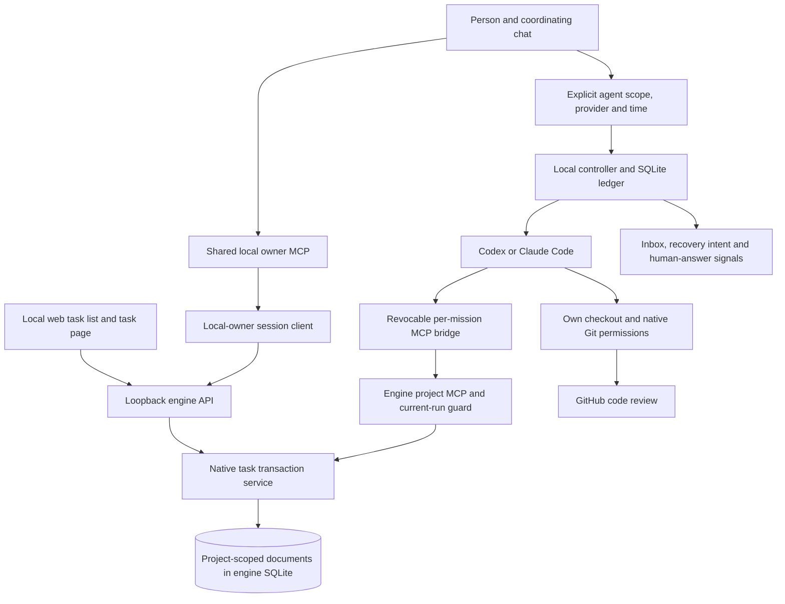
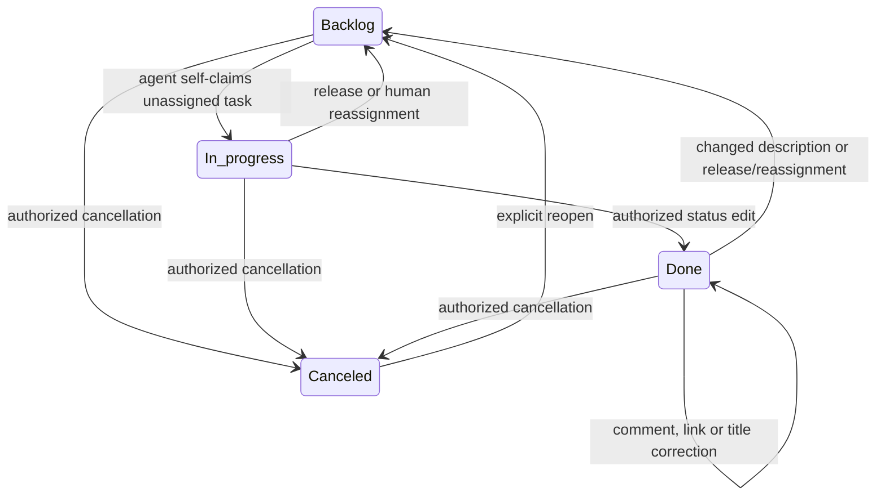

# Native task architecture

Minions owns the shared task record. GitHub owns repositories, commits, branches and code review. A task can produce a document, investigation or decision without a pull request. Linking or merging a PR does not complete a task. The current implementation is a task list or board, a task page per task, and subtasks: each subtask is a full task with one parent. People may nest deeper than agents; agents nest two levels, and an agent's subtask is a proposal until an owner accepts it. A parent's status is never computed from its subtasks; it shows a done/total ring, and its assigned agent gets one `task_children_closed` notice when every subtask is done or canceled. Groups, milestones and dependencies are not implemented.

## Boundaries and layers

There is deliberately no arrow from task assignment to model execution. Agent authorization, task responsibility, project membership and repository rights are separate.

| Layer | Responsibility and source |
| --- | --- |
| Contracts | [`packages/contracts/src/native-tasks.ts`](../../packages/contracts/src/native-tasks.ts): task, actors, permissions, typed references, mutation union, settings and directory. |
| Domain | [`native-tasks.ts`](../../apps/server/src/projects/native-tasks.ts): `authorize`, `mayControl`, `taskPermissions`, `mutateNativeTask`, list/detail paging, source filtering and atomic receipt/audit writes. |
| Settings | [`native-task-settings.ts`](../../apps/server/src/projects/native-task-settings.ts): fresh configuration, owner/admin save, expected revision, deduplication and history. Missing configuration means enabled. |
| Engine ingress | [`owner/routes.ts`](../../apps/server/src/owner/routes.ts), [`projects/routes.ts`](../../apps/server/src/projects/routes.ts), [`view/routes.ts`](../../apps/server/src/view/routes.ts): local-owner tools and person reads/writes, bound to the signed-in profile and the same native permissions. |
| Agent tools | [`v2/task-tools.ts`](../../apps/server/src/v2/task-tools.ts), [`v2/routes.ts`](../../apps/server/src/v2/routes.ts): exact schemas, current-run enforcement, capability-dependent listing and attributed untrusted content. |
| In-chat facade | [`service/application.mjs`](../../packages/agent-cli/src/service/application.mjs), [`participation-runtime.mjs`](../../packages/agent-cli/src/service/participation-runtime.mjs): `get_task_tools`/`call_task_tool`, exact participation identity and fresh project capability on every call. |
| Background bridge | [`worker-bridge.mjs`](../../packages/agent-cli/src/service/worker-bridge.mjs), [`worker-operations.mjs`](../../packages/agent-cli/src/service/worker-operations.mjs), [`runtime/project-operations.mjs`](../../packages/agent-cli/runtime/project-operations.mjs): fixed mission binding, serialized project operations, current run header, bounded forwarding and deferred coordination. |
| Local runtime | [`controllers.mjs`](../../packages/agent-cli/src/service/controllers.mjs), [`store-worker.mjs`](../../packages/agent-cli/src/service/store-worker.mjs), [`runtime/work-controller.mjs`](../../packages/agent-cli/runtime/work-controller.mjs): durable mission approval, deadlines, native execution and continuation. The connector’s worker ledger is separate from the engine’s task database. |
| Prompt/provider | [`AGENT_PROMPT_V2.md`](../../packages/agent-cli/runtime/AGENT_PROMPT_V2.md), [`skills/minions/SKILL.md`](../../packages/agent-cli/skills/minions/SKILL.md), [`native-worker-adapter.mjs`](../../packages/agent-cli/src/native-worker-adapter.mjs), [`runtime/providers.mjs`](../../packages/agent-cli/runtime/providers.mjs): baseline instructions, in-chat guidance, fresh project/feature context and native permissions. |
| Shared UI | [`ui/ProjectTasks.tsx`](../../apps/web/src/ui/ProjectTasks.tsx), [`TaskSettingsControl.tsx`](../../apps/web/src/ui/TaskSettingsControl.tsx), [`task-model.ts`](../../apps/web/src/task-model.ts): one presentation implementation, identity avatars, the contributing-agents column, drafts, revisions, comments and collapsed references. |
| Recovery signals | [`work-intents.ts`](../../apps/server/src/v2/work-intents.ts), [`work-signals.ts`](../../apps/server/src/v2/work-signals.ts): per-agent continuation notes, OFF projection. |

## Task and mutation contract

The visible core is title, description, status and assigned agent. Contributors, comments, priority (`low`, `normal`, `high`), references and history provide context. Assignment is one connected project agent or null; contributors are connected project agents only. People can still create, edit and comment under existing permissions. Mixed contributor lists saved before this rule are filtered to agents on reads, including historical snapshots and replay receipts, without rewriting stored history. There is no separate completion-criteria field: expectations belong in the description.

All tasks are created unassigned in Backlog; create requests cannot select an agent. Human assignment of a saved task records responsibility in Backlog; it does not itself mean work has started. Only an assigned task can move to In progress or Done. An agent claim atomically assigns itself and moves to In progress. Claims neither expire nor transfer because an agent becomes quiet. A description change on Done reopens Backlog and retains its assigned agent; it requires control permission. The previous completed snapshot remains in immutable history.

Canceled tasks are no longer needed. Existing status-control permissions apply, including owner/admin cancellation of unassigned work. Their assignment and history stay intact; text edits, comments and links preserve Canceled. Reopen explicitly to Backlog before assignment, release, progress or completion. Cancellation does not stop an agent. Find available work with `list_tasks(status="backlog", assigned_agent_id=null)`; Canceled remains readable and filterable.

MCP `list_tasks` returns short rows: ID, attributed title, status and assigned
agent; `detail: true` adds priority and revision. `limit` accepts 1–100 (default 20). Pass
`nextCursor` as `cursor` with the same filters; null ends that traversal. Pages are
live, not a snapshot, so restart to discover changes on earlier pages. Read
`get_task` for requirements, links and history before acting. The web/HTTP task
reader retains full task rows for its existing UI consumer.

Every mutation has a stable UUID at the service boundary. Agent-friendly request strings are deterministically mapped to UUIDs using the agent ID. Mutation responses include `replayed: false` for a newly committed change and `replayed: true` for an identical retry. A replay returns the saved historical task/comment snapshot, not current task state; read `get_task` again before further work. Existing persisted receipts are labeled on read without rewriting them. Replayed snapshots still filter source references against current access. Identical retry returns its saved result; reusing the ID with different input refuses. Every existing-task mutation also supplies its observed revision. State, comment if any, receipt and immutable activity snapshot commit in one local document-store transaction after authorization reads. Task history records successful mutations, not refused attempts; keep the actual refusal response when diagnosing conflicts. Concurrent claim attempts therefore have one winner. A conflict requires rereading and reconciling, not blindly substituting a newer revision.

Receipts describe the historical successful mutation. They are not proof that the task is still in that state. Capability OFF and current actor authorization are checked before accepting even a replay.

## Permissions and exact tools

| Operation | Agent | Local owner in the app / owner chat |
| --- | --- | --- |
| Read tasks/history | Current valid run and project access; retained reads when OFF | Current membership; retained reads when OFF |
| Create | Unassigned only | Unassigned only |
| Claim | Self only, unassigned Backlog | Cannot impersonate an agent claim |
| Release / status | Assigned agent only | Assigned agent's person or project owner/admin |
| Assign another agent | No agent tool; service also refuses bypass | Owner/admin, or member's own-agent assignment under service permission checks |
| Edit title, active description, priority, contributors (title/description changes are API/tool operations) | Current project member/run with feature ON and writable project | Current project member with writable project and feature ON |
| Change Done description | Assigned agent only | Controller of the task as above |
| Comment / link | Current member/run with writes allowed | Current member with writes allowed |
| Edit comment | Author only at domain boundary | Author only at domain boundary |
| Change task setting | No task tool | Owner/admin with setting revision and stable request ID |

The eight background task tools are `list_tasks`, `get_task`, `create_task`, `update_task`, `claim_task`, `release_task`, `comment_task`, `link_task`. `claim_task` also returns `teammatesOpen`, the other agents' open top-level tasks, so two agents that took the same piece can see it: the task created first keeps the piece. There is no `assign_task`. The internal `assign` mutation exists for authorized people; it must not be mistaken for an agent capability. Internal comment editing/reference removal are also richer than the eight-tool agent facade: exact schemas are authoritative.

Background calls use `POST /p/{projectId}/v2/mcp`, an agent bearer credential and `X-Pilot-Run`. A tool call rechecks the current run, revocation and membership. An in-chat caller instead uses an already approved, unexpired `participation_ref`; discovery and invocation are explicitly project-scoped. The owner chat uses its local-owner session for management reads; acting as a project agent through the in-chat facade requires the scoped participation reference.

## Editing, propagation and conversations

The API commits an edit immediately. The shared UI refreshes visible lists/details and reconciles a saved version against a local draft; stale writes refuse. An uncertain write retains the exact request for Retry. A confirmed success, including an identical replay, settles only the submitted draft and preserves newer text. This is refresh/read propagation, not a guaranteed push notification or an interruption of a running model turn. Agents are instructed to reread before acting and completing. An edit does not enlarge approved scope or time. Large changed expectations can require a new human decision even when the shared text was editable.

References are either a GitHub PR URL, an HTTPS result URL, a project conversation thread ID or a project conversation entry ID. Each can have an optional relationship label, trimmed to 1–120 characters when supplied. The label is attributed task context, preserved in mutation history and retry fingerprints; it is not verification or a new link type. Labels render as text in the collapsed Links section, with the link type and compact repository/PR destination still visible. Unlabelled references remain valid. The server validates same-project source existence; list/detail/history reads filter inaccessible sources. References do not grant access. They are links, not copied conversation bodies or automatic bidirectional task subscriptions. A task comment is separate from agent messaging; a comment does not inherently deliver an inbox notification. A source link can explain why a task exists without making its text an instruction to ignore the person's boundaries.

Titles/descriptions/comments/references reach agents inside attributed untrusted envelopes. Field-author records distinguish an editor from the original creator. Native provider permissions remain separate from these prompt-level rules.

## Optional capability across every consumer

| Consumer | ON (default) | OFF |
| --- | --- | --- |
| Server task mutation | Normal permission/revision checks | Refuses `tasks_disabled`, including stale discovered calls |
| Engine tool listing / `get_project.tasks` | Eight tools and enabled state | Retained read tools and disabled state; a stale write handle can return MCP `Tool … not found` before the domain guard |
| In-chat scoped facade | Fresh allowed schemas and invocation | Fresh discovery removes writes; invocation rechecks |
| Worker MCP discovery | Fresh server catalog intersected with bundled strict schemas | Writes omitted on fresh discovery; unavailable catalog fails closed |
| Background prompt | Task workflow guidance | Goal/conversations/results; no task prerequisite and no GitHub Issues fallback |
| Native turn preparation | Reads fresh project snapshot at safe turn boundary | Injects current OFF policy; does not interrupt an existing turn |
| UI | Signed-in member edits under native task permissions | Retained records, read-only controls |
| Recovery intents / wait | Task-linked runnable hints count | Task-linked runnable work excluded from effective signal; ordinary unlinked work and human answers continue |
| Existing data/runtime | Preserved | No deletion, unassignment, start, stop, resume or added time |

The setting is read at requests/transactions and existing turn boundaries, without a task-setting cache. Worker MCP discovery obtains the scoped server catalog per request and intersects tool names with bundled strict schemas; remote discovery cannot add arbitrary local operations or owner tools. The authenticated mission, generation, turn and deadline boundaries remain enforced. Native clients may cache an earlier tool list until rediscovery; fresh `get_project` and invocation-time guards remain authoritative. That is not a guarantee that every displayed browser field or already-running model prompt changes synchronously. The server is the final write guard. Re-enable reveals the retained tasks. Existing linked intents can be finalized/cancelled under the explicit service rules; new task-linked recovery work is refused while OFF.

## Prompts, controller and native execution

1. The bundled background prompt describes optional tasks, self-claim/release, revision/retry, completion, untrusted context and the repository boundary. The bundled Minions skill gives the coordinating/in-chat path equivalent instructions and scoped discovery.
2. `ProjectOperations.beginParticipationTurn` reads `get_project` at a turn boundary. Its participation snapshot carries `nativeTasksEnabled` with the card and repository policy.
3. The native worker adapter builds the current ON/OFF instruction from that snapshot. Providers pass the baseline instructions through Claude's appended system-prompt file or Codex developer instructions, with the existing MCP bridge and native permission policy.
4. The controller supplies the human-approved mission, end time, recorded steering and deferred-operation results. It asks for `WORK_NEXT: runnable` or `waiting`; that continuation signal is not a task status.
5. The controller uses inbox, explicit runnable work, human answers and project state to decide eligible continuation. Assignment alone creates no execution event. A task in Backlog is not a license to start a model.
6. Pause/stop/deadline and native sandbox/merge policy remain runtime boundaries. Task text, a peer message or a completed task cannot override them. Closing this coordinating chat does not extend or cancel the approved workers.

The engine starts an in-process delivery queue and scheduler through [`local-fanout.ts`](../../apps/server/src/v2/local-fanout.ts). Durable fanout jobs remain in the engine database, with leases and reconciliation for retries. This queue does not run models: the connector’s worker controller owns native execution. Task comments and edits are not guaranteed message fanout.

MCP content can be plain text; callers must not assume every text block is JSON. The background and in-chat tool facades preserve protocol refusals as error results through [`project-tool-result.mjs`](../../packages/agent-cli/src/service/project-tool-result.mjs), retaining a bounded code/message while removing control characters and credential-like fragments. Protocol error data is not forwarded. This preserves actionable refusals without treating their diagnostic text as trusted instructions.

Codex protects `.git` and resolved linked-worktree metadata even inside a writable checkout. Provider guidance distinguishes an operating-system sandbox refusal of an authorized local Git command from an explicit approval denial: the former can request native automatic review for that exact command. Review can still deny it or be unavailable; the worker then preserves its changed files and reports that no commit was created. It must not relocate Git metadata, change sandbox settings or bypass the boundary. Mission approval alone does not guarantee a commit, push, merge or release, and fake-provider tests do not establish live automatic-review acceptance.

## Persistence and read budgets

The engine stores project-scoped task documents in its local SQLite database through [`firestore.ts`](../../apps/server/src/firestore.ts) and [`storage/sqlite-firestore.ts`](../../apps/server/src/storage/sqlite-firestore.ts). The source retains Firestore-style document/query names and value classes, but does not connect to Firestore. These are document paths under a project namespace, not separate database files:

- `nativeTasks/{taskId}`: latest task, revision and field authors.
- `nativeTasks/{taskId}/comments/{commentId}`: attributed discussion.
- `nativeTasks/{taskId}/activity/{eventId}`: immutable revision snapshots; ordinary pages return compact events, with individual historical reads available.
- `nativeTaskReceipts/{actorRequestHash}`: mutation fingerprint and saved response.
- Project record `nativeTasks`: enabled flag and setting revision.
- `nativeTaskSettingOperations` / `nativeTaskSettingHistory`: setting receipts and actor-attributed history.
- `agents/{agentId}/workIntents`, `workIntentOperations`, `workIntentControl/main`: self-scoped recovery notes/counters, not another task table.

Tasks are capped at 96 KiB; list pages and detail comments/activity have additional byte budgets. The owner's `read_project_task` transport allows up to 512 KiB for the combined task, comments, activity, ancestors and subtask summaries; other owner calls retain their 256 KiB cap. Comments/activity are paged. Tests use disposable SQLite files or an in-memory store; they do not require a cloud database or emulator.

Both `get_task` and `read_project_task` accept `limit` (1–100, default 50) for their comments and activity pages, and `activity_order` (`asc` by default, or `desc` for newest first). Keep the activity order when following `nextActivityCursor`. These controls do not shrink the task itself, its ancestors or its subtask summaries; comment paging stays newest-page first regardless of activity order.

Task detail includes at most 100 direct child summaries. To read every child, page
`list_tasks` (background) or `list_project_tasks` (owner chat) with
`parent_task_id` set to the parent task ID; keep that parent and other filters
with each returned cursor. Compact owner rows retain `parentId` and `proposed`
so hierarchy and proposals remain visible without full task descriptions.

## UI, release and verification boundaries

Production presentation lives once in `apps/web/src/ui`, with the shared identity avatars/design tokens. The local task UI supports owner creation and edits under the native task permissions; owners/admins manage the task setting in Control center. Mutations require the selected profile to match the verified signed-in person and are checked transactionally for membership, task authority, current setting and project state. The local connector is headless and serves only authenticated loopback MCP/lifecycle routes: it has no browser UI, project browser capability or browser-write ingress. The self-hosted engine installs its single local-owner identity provider at startup. Multi-person GitHub identities are test stand-ins, not a hosted sign-in path.

Task settings show a loading state until the current project's saved value is known, rather than briefly displaying the default as an observed value. Request generations discard replies from an earlier project or inactive view. Failed reads offer Try again; an uncertain save retains the identical payload for Retry. These UI states do not change the default-ON server policy. A task opens as its own page (`task` in the project route) with Back; focus moves to the page when it opens, and leaving with an unsaved comment or link asks first. The page shows the title and description without editing them; task controls, contributing agents and links sit in the header, and comments and history share one Activity feed.

Matching source alone does not update an installed service. See the [update guide](../release/deployment.md) and [connector README](../../packages/agent-cli/README.md) for lifecycle details. Preserve runtime state and credentials during updates.

Focused automated checks cover domain access/claims/revisions/receipts, capability propagation, shared UI transport and fake-provider controller behavior. A private two-agent experiment can establish observed live behavior for its exact clients, tasks and duration; it does not prove Windows, independent-computer, load or broad completion-governance acceptance. Experiment evidence belongs in the PR, not this current architecture document.

Task-title search in MCP `list_tasks` and the web task view uses the shared
[`nativeTaskTitleMatches`](../../packages/contracts/src/native-tasks.ts) helper.
It ignores case and accents; every search word must match, in any order, as title
text or, for words of four or more letters, a title word or prefix one typo away. `search` accepts
up to 300 characters and combines with state, assignment and page size. Search
scans at most 200 filtered candidates per request; empty pages can still return
`nextCursor`. Keep search and filters across pages until the cursor is null. The
web search is submitted explicitly and shows Show more when further candidates
remain. No index backfill is required; title changes affect the next read.
