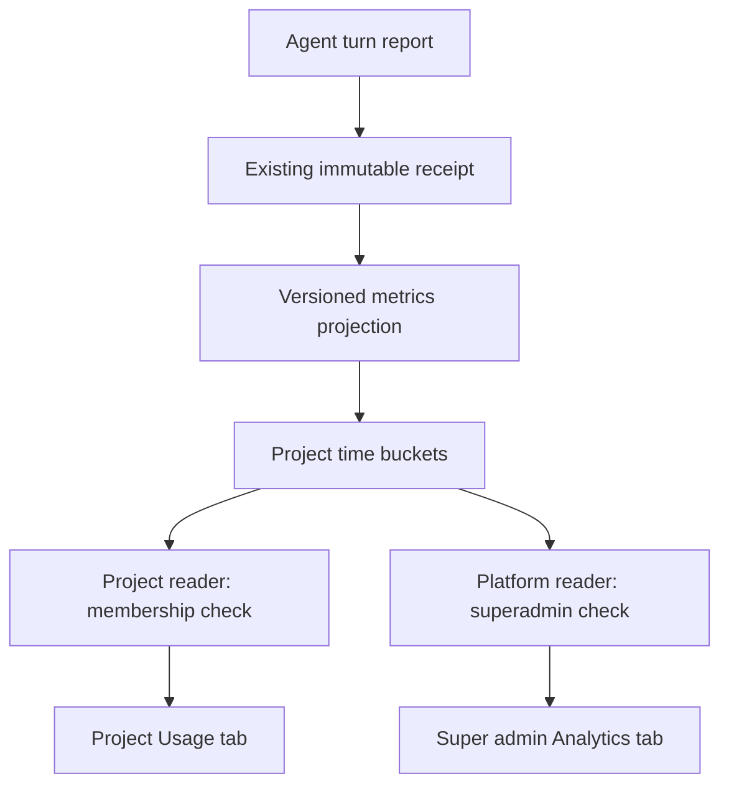

# Paperclip and Minions: current adoption and core gaps

Reviewed: 26–28 October 2026, with specialist adoption audits followed by independent reviews of necessity, implementation risk, metrics and access scope.

## Recommendation after the 28 October main check

The earlier 28 October recommendation review used fetched main `5b3291d7e41f7209c420cc99c8ff22671a28dfed`. Targeted inspection at that revision reconfirmed that launch schemas still expose provider/model without effort, no model-discovery MCP tool exists, task routes still omit individual task identity, task activity still omits run ID, and the proven zero-turn refusal still reaches the submitted/uncertain branch. This was a targeted revalidation of the recommendations, not a new comprehensive upstream or production audit. The later analytics follow-up below uses `b7816ef4`; it does not repeat that entire boundary audit. The earlier native model catalog below was observed on 26 October and is not a fixed availability list.

| Order | Recommendation | Participant benefit and smallest implementation |
| --- | --- | --- |
| First repair | Correct proven no-work provider rejection and expose saved failure facts | Approved work can take its existing safe retry instead of unnecessarily entering recovery. Reuse rejected delivery and the existing authenticated diagnostics; preserve uncertainty for unproven execution. This is our integration repair, not code to import from Paperclip. |
| First adoption | Discoverable, explicit execution settings through MCP | People and their coordinating chat can see the installed client's models/efforts and choose deliberately. Add one read-only capability tool and optional effort through the existing approved execution path, including fingerprints and native forwarding. Our specific-agent/provider/model launch already exists. |
| Second adoption | Navigable, attributable work history | Updates/messages should open the exact task, and a task mutation should identify its validated run. Add a task route/Copy link and optional run ID in existing history. Use existing readers, permissions, receipts and records. |
| Later, from demonstrated need | One-way human-help task link; hierarchy/dependencies | Add a task link inside an authorized help request when blocker context is repeatedly lost. Design dependency semantics for a real complex coordination workflow before implementing them. |

Borrow Paperclip's mechanisms and adapt them to Minions's existing runtime. Start with execution settings fixed for the approved mission: copying per-task model overrides into a running mission would require additional semantics because one turn can touch several tasks. Discovery returns evidence about supported choices, not authority to launch, remaining quota or a guarantee of successful inference. Keep missing/fresh/curated observations explicit and require supported model/effort combinations.

Keep these changes in focused, complete slices with regression tests at the actual boundaries. Full retained-history reconstruction, a common test framework, automatic model routing, new budget enforcement, organization hierarchy and a replacement controller do not have a demonstrated need in this batch. Revisit each only when a concrete consumer or repeated failure makes it cheaper than the current tools. No application change, product-policy selection or release is performed by this recommendation.

## Mechanism comparison for the recommended changes

Follow-up source comparison: the relevant launch, refusal and diagnostic boundaries were rechecked against remote Minions main `897368074aecb0f51ef6d56b696e0e4769fc24f1`; task contracts/routes are unchanged from the preceding main review. Paperclip remains the inspected `a67a18c` snapshot. These are source observations, not claims of live acceptance or an audit of newer upstream Paperclip.

| Change | Minions implementation | Paperclip implementation | Recommended Minions slice and reason |
| --- | --- | --- | --- |
| Safe provider refusal | Classifies provider limits and marks proven zero-turn refusal retryable, but the controller still settles its submitted delivery as uncertain before retry scheduling. | Claude/Codex adapters distinguish quota/authentication/transient error families and can return retry-not-before evidence. This does not establish identical lost-acknowledgment safety. | Correct our narrowly proven rejection using the existing rejected/steering/retry path. It restores intended behavior with no new controller; leave reset-aware waiting as separate policy. |
| Failure explanation | Private outcomes, journals, report/cleanup diagnostics and read-only owner tools exist. Diagnostic lastOutcome omits the saved failure code, retryability and native phase. | Runs retain error code, structured result/usage, log references and events available through run readers. | Project existing safe scalar facts into the current diagnostic tool, so an operator can distinguish quota, authentication, permission, local failure and uncertainty. No new log or health platform. |
| Model and effort controls | MCP targets the specific owned agent and accepts provider/model. Strict launch schemas have no effort, and MCP has no model inventory. | Saved agent adapter defaults and task-specific overrides; model-specific effort helpers; provider-native mappings. Built-in Codex discovery uses a curated catalog. | Add read-only native capability discovery and optional immutable mission effort. Carry it through queue/fingerprint/adapter and show requested versus observed settings. This completes informed launch control without a broad adapter registry. |
| Direct task navigation | Stable task IDs and authorized get-by-ID exist; drawer selection is component-local and URL routing lacks a task parameter. | Issue detail routes and a shared issueUrl helper select an issue by readable identifier or ID. | Route to the existing drawer using the existing task ID and add Copy link. Updates and messages become useful entry points; a new human-readable ID allocator is unnecessary. |
| Task mutation provenance | Events retain attributed actor, action, revision, time and snapshots. The authenticated run is checked but omitted from the event. | Activity records have optional agent/run identity, entity identity and responsible user, with runId linked to run records. | Record the validated run ID on new agent task events, preserving original attribution on exact retries. Correlate shared task history with existing owner run inspection; never infer current-task execution or per-task token totals. |

Paperclip source: [provider outcome classification](https://github.com/paperclipai/paperclip/blob/a67a18c171816b097f46eae78fc58c7e55c9c565/packages/adapters/claude-local/src/server/execute.ts#L1237), [run record](https://github.com/paperclipai/paperclip/blob/a67a18c171816b097f46eae78fc58c7e55c9c565/packages/db/src/schema/heartbeat_runs.ts), [issue URL helper](https://github.com/paperclipai/paperclip/blob/a67a18c171816b097f46eae78fc58c7e55c9c565/ui/src/lib/utils.ts#L261), [activity schema](https://github.com/paperclipai/paperclip/blob/a67a18c171816b097f46eae78fc58c7e55c9c565/packages/db/src/schema/activity_log.ts). Model/effort sources and implementation boundaries are detailed below.

## Context telemetry and focused testing

Context telemetry answers which application-supplied material reaches a model turn: instructions, turn prompt, tool catalog and tool responses. Provider token usage answers how much input/output/cache usage was reported. Neither alone explains the other, especially with native resumed sessions and provider-managed context. Model work quality requires separate behavioral evidence.

Minions already records provider/model identity, token/cache coverage, duration, partial tool counts, private run evidence and immutable delivery receipts. At the pre-implementation review, bounded MCP byte/category helpers were unwired: accounting used the listener rather than the worker facade, local validation excluded context, and cloud normalization omitted it. The first working-tree slice now connects facade-returned catalogs, sanitized replies and workflow-guide reads with prompt/instruction sizes, strict local validation and cloud normalization. Summaries explicitly identify partial Minions-supplied context. Focused synthetic tests cover these boundaries, including the actual HTTP bridge; this is not a deployed feature or native Windows acceptance. A server schema alone never establishes measured reporting.

Paperclip's inspected ACP prompt builder emits `promptMetrics` with character counts for instructions, bootstrap, wake prompt, handoff, task context, runtime notes and heartbeat text; metadata carries those metrics alongside other run information. This is useful attribution at the prompt-construction boundary, not complete provider context/token measurement. See [prompt construction](https://github.com/paperclipai/paperclip/blob/a67a18c171816b097f46eae78fc58c7e55c9c565/packages/adapter-utils/src/acpx-engine/execute.ts#L3105).

Keep the measurement scope concrete: count fixed prompt sections and each canonical tool’s actual facade-returned definition, argument and result sizes per immutable turn, with calls/refusals. Preparation reads stay separate from model-facing material. No bodies, argument values, local paths or credentials enter numeric summaries. Preserve partial/unavailable coverage and fence late replies. The owner-selected project and platform tabs are the aggregate consumers; cloud reporting preserves immutable queued payloads.

Selected presentation: Project Usage and superadmin Analytics show source attribution with bounded agent/run/turn drilldown, through separately authorized numeric readers. The browser never reads private local diagnostics or transcripts. Provider usage stays secondary; matched live comparisons remain separate opt-in experiments. Testing evidence belongs in PR check summaries and local validation reports, with expandable expected/observed results and clear fixture/native/live labels. Live model comparisons remain separate opt-in evaluation reports. Concept previews use synthetic data and do not establish implemented features or measured results.

Testing infrastructure already includes isolated domain/emulator tests, real HTTP/MCP tests, protocol fixtures, controller/store and process-cleanup tests, portable/native jobs, packaged-install checks and structured suite output. Newer native-smoke tooling records source/client/platform/model observations. These serve different evidence scopes; a real model against synthetic coordination is not production-backend acceptance, and a simulated platform is not native acceptance.

Paperclip combines adapter/protocol tests with a Promptfoo behavior suite. Its current eval README distinguishes existing narrow checks from later framework phases. Some core YAML cases use text-contains assertions such as checking for `409` or `comment`; those inspect output text rather than proving the requested tool action occurred. Borrow concrete scenarios, and prefer observed calls/state/refusals when claiming execution behavior. See [eval scope](https://github.com/paperclipai/paperclip/blob/a67a18c171816b097f46eae78fc58c7e55c9c565/evals/README.md) and [core assertions](https://github.com/paperclipai/paperclip/blob/a67a18c171816b097f46eae78fc58c7e55c9c565/evals/promptfoo/tests/core.yaml).

The immediate testing investment is a few complete boundary regressions in existing suites: provider parser → real controller/store → safe retry; MCP launch → approved settings → native argv/RPC; task mutation → single immutable event/receipt. The earlier zero-turn refusal is a concrete example: a passing classifier test did not prove the controller retried. For telemetry, use two synthetic turns with known tool results and a delayed reply; assert exact scoped counts, unknown/partial handling and no contamination. Extract shared fixtures when multiple real consumers need them, without a new test DSL or evaluator service.

Add a small separately approved live behavior set only when choosing between prompts/models requires it. Pin model/effort, guide/source and client version, inspect actual tool effects, repeat stochastic cases and report tokens with unknown/partial coverage. Include scenarios such as respecting a stale task revision, honoring Pause, acknowledging a human answer and continuing independent work. A scripted fixture proves application mechanics; a live eval samples model compliance. Keep ordinary CI free of unselected model execution. No tests or inference were run for this explanatory source review.

## Project and platform analytics from the same evidence

The owner requested plots in a project tab and a superadmin view across all projects on 28 October. This identifies a concrete consumer for cloud numeric summaries, expanding the earlier local-diagnostics-first proposal. The following design is being implemented in the working tree; the tabs are implemented in the working tree and have synthetic local-app coverage; they are not deployed. The receipt projection, bounded readers, telemetry and initial context-first tabs have focused synthetic coverage. Run-timeline integration and scoped native scalar observations are implemented with synthetic coverage; an owner-selected live direct-model pair has passed; final release acceptance remains separate. The implementation branch is based on main `431ce750`; current code, validation and remaining acceptance are tracked in draft PR #402.

### Authorized implementation sequence

The owner approved starting this plan on 28 October, including context collection in the initial foundation. Checked items below describe implemented source and validation, not deployment. The selected live comparison and native-platform evidence are recorded in PR #402; they do not establish a general project baseline. Release remains separate.

- [x] Wire numeric context collection on the actual worker facade and preserve it through local outcome validation and cloud reports. Measure supplied instructions, assembled turn prompt, returned tool catalog and sanitized tool replies; exclude preparation reads, retain absent measurements as unknown, and fence delayed replies at turn boundaries. Verify synthetic exact byte counts, refusals, retries and two-turn isolation without model execution.
- [x] Build versioned, receipt-derived UTC daily metrics with atomic deduplication, late-report handling, rebuild/reconciliation and per-metric coverage. Add bounded project and platform readers under their existing distinct authorization checks; test removed-member and warm-cache denials.
- [x] Present concept directions before substantial UI changes, then integrate shared charts in Project Usage and Superadmin Analytics. Verify actual local app behavior with isolated emulator data, account/project switching, empty/partial states and query bounds.
- [x] Keep test/eval records separate, run focused release checks, and record remaining native-platform acceptance in the PR. Deployment and real inference retain their explicit authorization requirements.

### Context measurement: binding goal acceptance contract

Owner clarification, 28 October: context measurement definitions and pinned Paperclip references are part of this goal's acceptance, not optional follow-up research. The complete goal remains telemetry, receipt-derived metrics, authorized project/platform readers, both integrated tabs and local verification. This section supplements the active goal text.

**Primary participant question — owner clarification, 28 October.** The owner accepted the dashboard direction but clarified that conversation, input-prompt and steering context pressure is the main purpose. Usage/cost-style reporting is supporting evidence. The implementation must answer both “how much context is occupied, where observable?” and “which supplied sources contribute or grow across turns?”. A token-usage dashboard with an advanced byte disclosure alone does not satisfy this goal.

The owner subsequently rejected the image generator’s understanding of this purpose. Its usage-oriented comparison board is not an approved primary context specification; continue with a functional outline and actual application rather than further image iterations.

The primary context surface needs a bounded agent/run turn timeline, retaining numeric observations and source coverage, with project and platform summaries derived from the same facts. Distinguish new steering, approved mission/runtime instructions, project/task/persona material, retrieved conversation/inbox text and other tool results at their actual construction/return boundaries. Current whole-prompt totals and broad tool categories are a starting point, not sufficient attribution of steering or conversation growth. Freeze the expanded contract before parallel implementation and preserve existing immutable reports.

Track native context occupancy/capacity and compaction only when actual client/provider observations establish their meaning; inspect the installed protocol before selecting fields. Cumulative token usage and a model's advertised capacity do not prove current occupancy. Preserve unknown where native observations are unavailable. Paperclip's [ACP usage readout](https://github.com/paperclipai/paperclip/blob/a67a18c171816b097f46eae78fc58c7e55c9c565/ui/src/components/task-chat/TaskChatUsageReadout.tsx#L11) separately consumes reported `used` and `size`; it is a different measurement from prompt character attribution below.

Show supplied-source byte attribution alongside provider token/context observations with distinct units; do not present byte shares as token shares. Repeated reads can be reported as returned bytes, but a repeated-context claim needs actual identity/comparison evidence. Session reuse does not prove how much history the native client retained. Do not sum occupancy percentages across agents or time; aggregate identified snapshots with explicit sampling coverage. No automatic trimming, summarization, steering changes or session resets are authorized by this measurement work.

**Project-specific overhead — further owner clarification, 28 October.** The primary deliverable measures the extra context Minions adds to this project compared with doing the same work directly through the native model client. Break out the initial/runtime prompt, steering, project/persona material, conversation/inbox retrieval, task retrieval/mutations, MCP tool definitions/catalog and each canonical MCP tool's returned material. Broad tool categories alone do not satisfy this requirement. Native occupancy observations remain useful supporting evidence, not a substitute for attribution of application overhead.

Instrument the real construction and return paths with exact numeric UTF-8 measurements; retain fixed source IDs and canonical tool names from our own catalog, never arbitrary labels or payload bodies. Count tool-definition bytes separately from invocation arguments and returned text. Distinguish the first prompt/catalog from subsequent turn additions and explicit repeated deliveries; do not infer retained-context shares from accumulated bytes. Project readers must show both project aggregates and bounded run/turn drilldown.

A separate controlled direct-versus-Minions benchmark must hold the task, fixture state, selected model/effort, client/version, permissions and session phase constant. Report initial and subsequent-turn input/cache/output usage separately, and disclose the measured configuration and coverage. No synthetic test data enters project analytics. A directly supplied task and the Minions-mediated task must have equivalent work/information requirements; a zero-task baseline cannot establish coordination overhead. A matched benchmark establishes observed total overhead for that scenario, not a universal per-project percentage or causal allocation to individual tools. Per-source tokenization, if provided, must name the tokenizer/model and be labeled an estimate unless actual client/provider measurement establishes exactness. Never allocate provider token totals proportionally to byte counts. No live inference until the operator explicitly selects an available model, effort and bounded benchmark task.

The source-only [capture harness](../../../packages/agent-cli/scripts/measure-context-overhead.mjs) implements a fixed two-turn task and steering scenario per arm, using the real worker facade/catalog/instructions and native supervision with synthetic coordination. `--describe` reviews the scenario without inference. The [benchmark instructions](../../../tools/benchmarks/README.md#opt-in-native-capture) define explicit model/effort/platform/deadline selection, output verification and numeric-only comparison. Fake protocol tests establish harness mechanics; the owner-selected `gpt-6.1-sol` / `low` live pair passed with both results verified. Evidence belongs in PR #402; this one synthetic-coordination scenario does not establish a general project baseline.

**Attribution is not automatically overhead.** A task description, relevant conversation facts and a human's changed instruction may also be necessary in the direct-model baseline. Count all supplied material by source, but reserve “overhead” for the observed difference between equivalent runs. The direct arm receives the same necessary task and conversation facts and the same steering change. The Minions arm retrieves those facts through its real scoped tools and receives its real instructions. Validate equivalent work results before comparing tokens. MCP schemas, response wrappers, coordination guidance and extra retrievals can contribute overhead; their causal token cost is not established by byte attribution alone.

| Project question | Measurement | Limit |
| --- | --- | --- |
| How much do conversations and tasks supply? | Per-turn returned text from each conversation/task tool, separately from its arguments and schema | Measures retrieved text, not the whole stored conversation/task database or retained native history |
| What do initial instructions and steering add? | Prepared instruction size, final prompt source sections and steering count, with new/resumed session identity | A prepared instruction on a resumed session is not necessarily newly consumed context |
| What does each MCP tool contribute? | Definition deliveries/bytes, completed calls, argument bytes and returned-text bytes under its canonical name | Native client reserialization, tool envelope tokens and non-text payloads remain outside exact byte coverage |
| How much more model input does Minions require? | Signed normalized input-token difference between matched direct/Minions runs; cache reads/writes and output differences shown separately | Scenario-specific; not a universal or project-wide baseline |
| How much of the model window is currently occupied? | Only a native observation that explicitly establishes used context and capacity | Last-input tokens and cumulative usage do not establish occupied history |

**Reference to adapt.** Paperclip snapshot `a67a18c171816b097f46eae78fc58c7e55c9c565` builds `promptMetrics` at prompt construction: `promptChars`, `instructionsChars`, `bootstrapPromptChars`, `wakePromptChars`, `sessionHandoffChars`, `taskContextChars`, `runtimeNoteChars` and `heartbeatPromptChars`. These use JavaScript string `.length` (UTF-16 code units), despite their character labels. Metrics accompany execution metadata. Borrow attribution at the construction boundary and preserve explicit source semantics; do not present those counters as model tokens or assume all sections sum to the final prompt, including separators and unlisted guidance. Sources: [exact counters](https://github.com/paperclipai/paperclip/blob/a67a18c171816b097f46eae78fc58c7e55c9c565/packages/adapter-utils/src/acpx-engine/execute.ts#L3184), [execution metadata](https://github.com/paperclipai/paperclip/blob/a67a18c171816b097f46eae78fc58c7e55c9c565/packages/adapter-utils/src/acpx-engine/execute.ts#L5019). This is a pinned source comparison, not a claim about later upstream changes.

**Minions measurement definitions.** Exact UTF-8 byte counts use `Buffer.byteLength(text, 'utf8')`. They describe the material prepared/returned by Minions at the stated boundary, not provider tokenization or proof that a model consumed it.

| Field | Exact measurement and boundary |
| --- | --- |
| `instructionBytes` | Prepared worker instructions file; for Codex also the newline and permission guidance appended to its developer-instruction configuration. Claude's per-turn permission guidance belongs to the turn prompt instead. On resumed sessions this is the prepared instruction size, not a claim that all bytes are new context or billed again. |
| `turnPromptBytes` | Final assembled native turn prompt after permission guidance where applicable, current project/task-policy guidance, persona and attribution additions. Measure the actual assembled string, without logging its contents. |
| `catalogRequests`, `catalogBytes` | Count actual worker `tools/list` responses and UTF-8 size of `JSON.stringify(returnedTools)`. Internal transport registry construction and remote preparation discovery must not increment delivery counters. Repeated returned catalogs count repeatedly; zero requests does not mean the native client has no cached catalog. |
| `tools[].calls`, `argumentBytes` | Calls returning through the worker facade, and UTF-8 size of `JSON.stringify(validatedArguments)`. Sizes only; no values or arbitrary names are retained. |
| `responseTextBytes` | Sum UTF-8 lengths of text content in the sanitized result returned by the facade, including the local workflow-guide tool. Exclude non-text/image bodies; this is not complete protocol-envelope size. |
| `refusals` | Returned protocol/result refusals, attributed to the same fixed category as the call. Exceptions that do not return through this boundary are outside these counters. |

Retained category counters use only `project`, `discovery`, `updates`, `threads`, `messaging`, `checkpoints`, `coordination`, `other`; individual tool counters use the fixed canonical names of the shipped MCP catalog. Neither permits arbitrary stored labels. Start a fresh counter identity for each controller turn; close it on success or failure. In-flight replies retain their original identity and cannot enter a later turn's counters. Participation preparation and deferred background retries do not count as model-facing tool context. An internal native-session recovery may make multiple attempts within one controller turn: tool counters cover that turn; prompt/instruction sizes describe the final reported attempt. Keep that distinction visible in documentation and avoid summing them as one exact context-window size.

**Coverage and accounting.** New summaries declare `scope: minions-supplied` and `coverage: partial`. No summary means unknown; present zero means an observed zero within that limited scope. Aggregates retain metric-specific known-report and partial-report counts, rather than substituting zero for missing reports. Capture no prompt bodies, argument values, tool bodies, paths, credentials or arbitrary labels. Measurements must not change model authorization, execution/retry decisions or cleanup guarantees; unavailable collection omits the summary. Never rewrite immutable pending cloud reports to add measurements retroactively.

Provider-reported input/output/cache tokens remain a separate, secondary usage presentation. Normalize each receipt before aggregation: Codex input may include cache reads; Claude uncached input requires separately known cache reads and writes before constructing total input. Never convert bytes/characters into purported exact tokens or context-window occupancy. Supplied-source counters exclude native shell/file tools, client-managed conversation history and provider-internal/reasoning context. Separate Codex observations record matching-turn last-input/last-total tokens, an optional reported window and completed compaction events; these observations do not establish retained-history occupancy. A future context-window percentage needs an actual provider/client used-and-capacity observation with identified source and coverage.

**Required evidence before completion.** Known synthetic Unicode payloads must prove exact sizes; actual HTTP worker calls must prove registry reads are excluded and returned catalogs/replies included; two turns and a delayed reply must prove isolation; preparation/background retry paths must stay excluded. Validate numeric bounds, fixed categories, refusal counts and rejection of arbitrary metadata. Carry a summary through native composition, strict local validation, cloud normalization and the real HTTP receipt schema without widening payloads. Verify exact retries, late reports, mixed-provider normalization and unknown/partial coverage in daily aggregates. Both tabs must distinguish measured source sizes from provider token usage, show coverage and avoid fabricated percentages. Fixture tests, native platform checks and live inference retain their distinct evidence scopes; live inference is not authorized by this contract.

### Two views, one metrics contract

| Surface | Scope | Initial plots and controls |
| --- | --- | --- |
| Project → Usage | One project, under its existing active-member usage permission | Source-size trends and prompt/per-tool attribution with coverage; bounded run/turn drilldown and separate native observations. Input/output/cache usage is secondary. Filter aggregates by bounded date range and provider/model. |
| Super admin → Analytics | Cross-project numeric aggregates after the existing platform-admin check | The same source measurements grouped by project/provider/model, coverage and exact-project run/turn drilldown. Keep source units consistent across projects; do not sum occupied-window percentages. |

Keep chart components, formatting, metric definitions and response types shared. Use two separately authorized server entry points; an ordinary project endpoint must not accept a wildcard project scope. The platform router also serves ordinary users' invitations, so mounting an endpoint there is insufficient: apply `assertCommunityActor()` and `canAdminPlatform` inside the metrics service, as platform diagnostics does. Recheck authorization before using cached results; project/account changes must fence stale replies. Private local transcripts, instructions and tool arguments remain outside these aggregate DTOs. The earlier owner run-detail concept does not grant new readers access to its private local records.

### Reuse the receipt ledger and derive chart data

The existing `turnReports` receipts already retain per-turn model/provider usage, outcome, reported end time and server receipt time. They have deterministic identity, conflict detection and idempotent acceptance. Treat them as the facts; do not create another raw telemetry ledger. Existing `runnerUsage` remains useful for current lifetime totals, but its model/provider describe the latest contribution and its input semantics can become mixed. It cannot reconstruct historical usage by model or day.

Normalize each receipt with the existing token/cache rules before aggregating. Start with versioned project/UTC-day buckets and a fixed provider/model breakdown. Retain sums and per-metric known counts, received-report counts, and measurement-source/coverage information. Avoid a precomputed agent × model × effort × release × error × tool-category cube; add a separate projection only for a demonstrated query. Agent drilldown can initially read a bounded set of receipts. Platform queries use bounded buckets rather than every project's raw history; add fixed-shard platform/day totals when the project-bucket read budget warrants them, avoiding a single global counter hotspot. Do not silently return a partial platform total as all projects.

Keep report acceptance independent from analytics maintenance. A retryable projection transaction should atomically record an applied marker keyed by projection version + project + receipt and update the relevant buckets. A duplicate report or repeated projection cannot increment twice. Projection failures leave receipts available for retry/reconciliation and do not prevent workers from reporting. Retain deduplication evidence for as long as reprocessing can occur. Rebuild a new projection version from unchanged receipts and compare it before switching readers; never modify queued report payloads or invent missing historical measurements.

### Honest plots and bounded queries

- Input/cache normalization must happen per receipt. Codex input can include cache reads while Claude reports uncached input separately; raw counters cannot simply be combined. Compute cache ratios from paired eligible numerator/denominator contributions, not averages of percentages or unrelated partial totals. Tokens remain the primary usage unit.
- Preserve unknown versus observed zero. Return per-metric report counts, explicit time basis, query scope, schema version and freshness. Coverage describes received reports; it is not proof that disconnected computers delivered every turn. A maximum processed timestamp is not a completeness watermark.
- Keep reported turn `endedAt` and server `receivedAt`. Late reports can update older completion-time buckets; ingestion diagnostics use receipt time. Start with explicitly labeled UTC days. Arbitrary local-calendar days require appropriately finer source grouping, not relabeling UTC totals.
- Reported outcomes describe attempts, not task completion or quality. Summed turn seconds can overlap across agents; they are not elapsed project wall time. Means require sums/counts; duration percentiles need suitable distributions or histograms.
- Bound date ranges, points, groups and pagination on the server. Chart selection never triggers a browser scan across projects or direct reads from participant computers. Cache numeric results with scope/range/filter/version keys while rechecking authority; publish their freshness rather than pretending analytics are synchronous with existing current-total readers.
- Actual context-window token utilization, reasoning effort and detailed failure reasons need new end-to-end fields. Existing cloud token usage can support the first plots; prompt/tool sizes can support advanced diagnostics after collection is wired. Never convert tool bytes into a supposed total-context percentage. Context plots should show Not measured until real observations arrive.

For testing/evals, keep release/scenario/platform/model results separate from participant usage. Existing CI and native-smoke reports can later supply a superadmin Quality section keyed by release/source; fixture/live/eval labels and tokens must remain explicit. Synthetic examples must not enter production usage trends. A shared rendering library does not require one mixed data ledger.

Acceptance should cover duplicate and out-of-order reports, late delivery, mixed provider/cache semantics, metric-specific missing coverage, projection crashes/rebuilds, project isolation and denied cross-project reads. A removed member or non-superadmin must stay denied with a warm cache. Reconcile rollups against the same bounded receipt set and measure chart read cost as history grows. Retention, detailed context visibility and any further platform-wide dimensions require explicit implementation scope rather than accidental expansion.

Source: [turn receipts](../../../apps/server/src/v2/turn-reports.ts), [current usage reader](../../../apps/server/src/view/project-usage.ts), [shared usage semantics](../../../packages/contracts/src/reported-usage.ts), [project membership](../../../apps/server/src/projects/access.ts), [platform diagnostics authorization](../../../apps/server/src/platform/diagnostics.ts), [superadmin tabs](../../../apps/web/src/admin-main.tsx). This work needs one narrow projection/query layer on the existing backend; no warehouse, separate analytics service or generic dashboard builder is required for the initial scope.

## Main finding

Minions has implemented a meaningful part of the earlier recommendations: **task discovery, clearer task evidence, main-app editing and compatibility-aware idle updates**. Its ownership/execution foundation already existed and has been strengthened. The next investment should close specific broken or missing user paths: **a proven no-work provider refusal reaches the wrong recovery state; a shared task cannot be opened from its own URL; existing diagnostics omit useful saved failure facts**.

The earlier recommendation gave too much priority to absent infrastructure. Full context measurement, a universal conformance corpus and a typed result graph are not prerequisites for dependable current work. Small immutable task-run attribution is useful for investigation, but existing actor identity, transactional ownership and retries already provide the underlying safeguards.

“Implemented” means present in inspected source. It does not establish that code was copied from Paperclip or that this research caused the change. The S1025 comparison records some direct Paperclip-derived recommendations; other changes satisfy similar needs independently.

## Source and verification boundary

- Adoption/necessity audit: Minions `769df92cc4a9370360d03e5504b9d4936df5f6df`, which matched remote main at that review. The later model/effort investigation fetched and advanced this checkout to **`0c86ba9008166a6856933db90f52ff3e5f330bfe`, equal to origin/main**, preserving this document. Earlier feature/release statements remain qualified to their original audit; the model section below uses the newer source. Other chats' unfinished branches are excluded.
- Original baseline: `90ebc79dc6bc060fc3f7529553cfc4d292d0f414`, the merged native-task implementation. The earlier comparison remains in Git history.
- Original Paperclip reference: `2a9d527c68ab1d2e61b8408eed9a194603bddfca`. The subsequent model/effort investigation separately fetched **`a67a18c171816b097f46eae78fc58c7e55c9c565`** from upstream master into a temporary checkout; other adoption findings were not comprehensively re-audited against that newer Paperclip revision.
- Specialists inspected implementation, tests, commits and recorded release evidence. The preceding audit reran **14 provider-limit and scheduling tests; all passed**. A subsequent synthetic adapter test through the real controller and SQLite store reproduced the missed integration defect: `submitted + retryable:true` becomes `recovery_required / delivery_uncertain`; substituting existing `rejected` delivery stays `waiting`. This establishes the control-flow problem and the available state transition, not a completed fix or an exercised eventual retry.
- The reproduction used an unchanged temporary copy of the audited runtime, isolated disposable state and the existing exact Zod 4.6.5 dependency. No model was executed, and no existing service, installation or deployment was changed. Native parser/steering/crash acceptance remains part of implementation. Release statements below are repository-recorded evidence, not fresh inspection of production, computers or npm. No tracker was read or updated; Linear is retired from this repository's workflow.

## Original six recommendations: current status

| Recommendation | Status | Evidence and remaining gap |
| --- | --- | --- |
| Trusted task-event execution attribution | **Missing; small forensic improvement** | The service validates the run but task events omit it. Existing actor + run ID is sufficient; duplicating generation is unnecessary. |
| Execution diagnosis and read-only doctor | **Partial; reuse existing readers** | Running version, update status, compatibility and recovery readers exist. Surface saved failure facts before adding a doctor. |
| Measured compact context | **Missing end to end; defer** | Compact task pages landed. Actual production accounting, strict local validation and reporting all need work; a measured optimization question should justify it. |
| Shared semantic conformance and acceptance evidence | **Substantial layered coverage; targeted seams remain** | Independent service, real MCP, facade and browser tests already cover important guarantees. Absence of a common corpus is not a missing product guarantee. |
| Filtered task retrieval and existing-ID navigation | **Substantially implemented** | State, assignee/unassigned filters, literal title search, compact MCP pages and page-size control exist. Exact get-by-ID already existed. |
| Task/result/Needs you relationships | **Partial; navigation first** | Evidence labels and Updates guidance exist, but a URL cannot select a task. Enable ordinary task links before adding typed relationships. |

## What has landed

### Shared work discovery and lifecycle

Backend, agent tools and main-app task views now support state/assignment filters. MCP returns compact discovery rows and configurable page size; `get_task` supplies full requirements/history. Case-insensitive literal title search scans at most 200 filtered candidates per request. Sparse pages may be empty while returning a cursor. This is bounded discovery, not ranked full-text search.

Current task states are **Backlog / In progress / Done / Canceled**. Canceled retains assignment/history, requires explicit reopening and does not stop execution. Contributors are agents only. All new tasks, including human-created ones, start unassigned. These supersede the original report's three states and mixed person/agent contributors.

People edit tasks in the main Minions app. The separate local browser app was retired; the shared local service still owns background execution. Exact retries now explicitly label historical saved results, and UI reconciliation protects newer visible state.

Relevant commits: `5f3823eb` (state filters), `e0541877` (assignment), `19ea35e0` (compact MCP), `3c89e4c4` (title search), `fa3b6456` (Canceled), `046a346f` (hosted editing), `2069bdc0` (agent contributors). See [native task architecture](../../architecture/native-tasks.md), [task reader](../../../apps/server/src/projects/native-tasks.ts#L117) and [task tools](../../../apps/server/src/v2/task-tools.ts).

### Evidence and Updates

Optional relationship labels and guidance encourage result, PR and discussion links without mandatory completion gates. Task-aware Updates guidance ties significant posts to task evidence when Tasks is ON. Reporting follows meaningful work checkpoints rather than the old due-time reminder policy. Changes: `13134a70` and `b7b63cc2`.

This improves workflow but remains guidance and ordinary URL linkage. It does not establish canonical result identity, task-revision linkage or a source-validated human-blocker relationship. Model compliance is not guaranteed. See [reference contract](../../../packages/contracts/src/native-tasks.ts#L6) and [Updates](../../../apps/server/src/projects/progress.ts).

### Consented, compatibility-aware idle updates

The updater requires owner policy or an exact manual request, waits under a serialized whole-service idle fence, verifies metadata/archive identity and rechecks release/policy immediately before activation. Active work, participation and pending reports are not silently treated as idle. Authenticated status reports the actual running package version; My computers exposes update state.

Candidates are checked for updater protocol 1, store schema 6, Node requirements, package/version/skill/runtime bundle and SHA-512 integrity. This implements a useful narrow compatibility boundary; there is no need to invent a generic registry merely to match Paperclip.

Changes: `84fe2776` / [#352](https://github.com/oronanschel/openswarm/pull/352), `7cde0c83` / [#355](https://github.com/oronanschel/openswarm/pull/355). See [updater](../../../packages/agent-cli/src/service/updater.mjs), [installer](../../../packages/agent-cli/src/service/update-install.mjs), [authenticated status](../../../packages/agent-cli/src/service/installation.mjs).

At this audited commit, release history records deployed updater API/web controls and native updater installation/handoff acceptance on Windows/macOS/Linux. **beta.64 is prepared but publication awaits operator security-key authentication; recorded published npm remains beta.63.** This does not mean every installed computer has upgraded. Windows updater/setup acceptance is not Windows background-worker support; independent Windows worker supervision still refuses before launch. See [release history](../../release/deployment.md) and [connector README](../../../packages/agent-cli/README.md).

### Provider and operational safeguards

The S1025 Paperclip comparison explicitly identified provider-limit classification. `4baa337b` / [#338](https://github.com/oronanschel/openswarm/pull/338) adds `provider_limited` based on terminal errors, avoiding false authentication/permission classification from the model's prose. The classifier marks a narrow zero-turn refusal retryable, but the real controller still treats its submitted delivery as uncertain. The earlier unit-test pass did not establish end-to-end retry; the necessity review reproduced this gap below.

This is **not reset-aware quota recovery**: the controller still has short backoff and a three-failure limit. Long subscription exhaustion can still outlast the retries. Waiting for a proven reset within existing mission authority requires a separate bounded policy.

Validated opt-in `TRUST_PROXY` parsing also landed. Its production value remains an owner choice in release documentation; code presence does not prove deployed client-IP separation. Release preflight now verifies current remote main before cloud changes. Account/cursor/deadline/cleanup/platform regressions were strengthened. See [S1025 comparison](../../../reports/S1025/cl10-paperclip-comparison.md), [outcome classifier](../../../packages/agent-cli/src/native-worker-adapter.mjs#L56), [scheduler](../../../packages/agent-cli/runtime/work-controller.mjs), [proxy parser](../../../apps/server/src/trust-proxy.ts).

## Specific agent, model and effort through MCP

This targeted follow-up uses Minions main `0c86ba9` and Paperclip master `a67a18c`, with two specialist source audits. It proposes an enhancement; no launch capability was implemented or model executed.

**Paperclip supports this mechanism.** An agent stores its harness and default adapter configuration. Targeted wakeups run that agent; task-specific `assigneeAdapterOverrides` can select another model/effort for that task. Codex CLI maps `modelReasoningEffort` to `model_reasoning_effort`; its native runner passes `turn/start.effort`. Claude maps `effort` to `--effort` or ACP configuration. These controls differ by harness/model. See [override construction](https://github.com/paperclipai/paperclip/blob/a67a18c171816b097f46eae78fc58c7e55c9c565/ui/src/lib/issue-assignee-overrides.ts), [Codex mapping](https://github.com/paperclipai/paperclip/blob/a67a18c171816b097f46eae78fc58c7e55c9c565/packages/adapters/codex-local/src/server/codex-args.ts), [Claude mapping](https://github.com/paperclipai/paperclip/blob/a67a18c171816b097f46eae78fc58c7e55c9c565/packages/adapters/claude-local/src/server/execute.ts).

Paperclip also supports Gemini CLI, Cursor local/cloud, OpenCode, Pi, Grok, Kimi, OpenClaw, Hermes and generic process/HTTP adapters. This is a harness roster, not interchangeable effort support or proof of account access. For example, Kimi's CLI lane maps medium to high and its default ACP lane does not forward that setting; Gemini's ordinary adapter has no comparable effort field. Adopting another harness requires its own execution, permission, cleanup and platform work.

**Minions already handles exact agent and model selection.** [add_project_agent](../../../packages/agent-cli/src/owner-tools.mjs#L44) accepts provider/model; [control_agent](../../../packages/agent-cli/src/service/runtime-tools.mjs#L13) targets the exact existing owned agent/mission. Claude receives `--model`, and Codex receives model in its native thread configuration. Effort is currently rejected by strict execution schemas and never forwarded. No current MCP tool enumerates models or per-model effort. This controls separate background workers; a host coding chat retains its own model settings.

### Catalog evidence and actual local observations

Paperclip exposes a company-scoped adapter model endpoint, but its built-in Codex path deliberately returns a curated list instead of the broad OpenAI Models API, which also lists models Codex cannot execute. Its catalog entries contain ID/label; effort declarations live in separate helpers. Claude can discover API models with an API key and otherwise uses a curated catalog. These mechanisms do not establish subscription availability. See [registry](https://github.com/paperclipai/paperclip/blob/a67a18c171816b097f46eae78fc58c7e55c9c565/server/src/adapters/registry.ts#L1135).

The coordinator queried installed **Codex CLI 0.160.0** using only `initialize`, `initialized` and `model/list`, without creating a thread or turn. The initial sandboxed query timed out; the same bounded read outside the sandbox succeeded, returned one complete page and shut down. It advertised:

| Models returned by this computer's Codex client | Supported efforts returned |
| --- | --- |
| `gpt-6.1-sol`, `gpt-6-astra`, `gpt-6-sol`, `gpt-5.6-sol`, `gpt-5.6-terra` | `low`, `medium`, `high`, `xhigh`, `max`, `ultra` |
| `gpt-6-luna`, `gpt-5.6-luna` | `low`, `medium`, `high`, `xhigh`, `max` |

The returned default model was `gpt-6.1-sol` with default effort `low`. This is native catalog evidence, not a successful execution/remaining-quota test. [Official Codex documentation](https://learn.chatgpt.com/docs/app-server#list-models-modellist) explicitly provides `supportedReasoningEfforts` and `defaultReasoningEffort`; capability discovery should use those returned values.

Installed **Claude Code 2.1.302** help advertises `--model` and `--effort low|medium|high|xhigh|max`. No Claude account model catalog or inference was queried. Paperclip's curated examples include Fable 5.1, Opus 5.5, Sonnet 5.5 and Haiku 4.5, with model-dependent effort; those examples are not verified availability for this computer. Models continue to come from the person's signed-in provider, not Paperclip.

### Minimum complete adoption

1. Add one read-only owner MCP tool, for example `get_execution_options(provider?)`, that returns installed client/version, model IDs, per-model efforts/defaults, source and freshness. Codex uses its native `model/list`; Claude needs an appropriate documented discovery source or explicitly labeled curated/unknown results. Never require an API key merely to imitate an OAuth subscription's catalog. Bound pagination/timeouts/output, isolate account/computer cache identity, and never start inference to populate the picker.
2. Add optional `effort` to existing approved launch execution, retaining omission as the native default. Carry it through both add-agent/queued-start and direct control paths to Claude argv and Codex turn requests. Validate the actual provider/model/client combination, freeze the choice for the mission and preserve requested versus observed settings. Use the existing native session within that mission; changes to model/effort require a new approved launch. No silent substitution or arbitrary extra CLI arguments.
3. Include effort in the [queued-start fingerprint](../../../apps/server/src/owner/web-agent-starts.ts#L92), which currently hashes provider/model explicitly. Preserve old absent-effort request identities. Local command fingerprints already hash the full validated execution object. Store the new optional setting in existing execution JSON; no new table or SQLite schema version is needed.
4. Test real ingress-to-launch forwarding for first/resumed turns, unchanged exact retries, changed-effort conflicts, unsupported selections, no-inference discovery and failed/stale catalog reads. Accept the optional cloud field before matching bundled connector schemas produce it; release guide/catalog/runtime together and use the existing consented idle updater. Native/provider execution remains separately approved acceptance.

Explicit effort on the two current engines is a **low-to-medium scope extension**; honest account/computer discovery is **medium scope**. Borrow Paperclip's explicit execution settings, per-model capability treatment and native mappings. Keep Minions's current runtime and authority boundaries. A broad adapter registry or importing Paperclip's runner is not needed for this feature.

## What we actually need next

Judge an addition by a concrete participant problem, an existing consumer, the invariant it must preserve and a regression that demonstrates the improvement. Paperclip is a source of mechanisms, not a parity checklist.

### 1. Handle proven provider rejection correctly

**Problem:** Claude's terminal quota refusal with `is_error:true`, `num_turns:0` and no acceptance remains `delivery:submitted`. [The classifier](../../../packages/agent-cli/src/native-worker-adapter.mjs#L73) marks it retryable, but [the controller](../../../packages/agent-cli/src/service/controllers.mjs#L365) settles every submitted outcome before reaching the scheduler. [The store](../../../packages/agent-cli/src/service/store-worker.mjs#L574) also makes its steering uncertain. This unnecessarily requires recovery for a refusal the classifier intended to retry.

**Minimum change:** classify only the proven terminal no-work case as existing `delivery:rejected`. The store already requeues rejected steering, outcome validation already accepts it, and the existing controller applies backoff. Require a trustworthy Claude terminal result and no contradictory acceptance/tool activity or persistence fault. Preserve the submitted journal event and raw delivery diagnostic: terminal rejection follows submission and does not erase it. Missing reports, stderr-only 429, partially performed work and cleanup uncertainty retain their current protections.

**Acceptance:** parser → classifier → real controller/store regression with synthetic native input; steering is queued then applied once on the eligible retry; fresh authorization and deadline checks remain; Pause/Stop prevent further submission; a crash before terminal evidence remains uncertain. Existing acknowledged-failure behavior must remain unchanged. Test the eventual retry, not only the boolean flag. This is a connector fix with no new state, table, queue, scheduling policy or cloud contract. Do not automatically repair historical uncertain missions whose evidence is insufficient.

### 2. Make a task directly navigable

**Problem:** [the router](../../../apps/web/src/route.ts#L9) has no task identity, while [the task drawer](../../../apps/web/src/ui/ProjectTasks.tsx#L76) uses component-local selection. A copied URL or reload loses the selected task, even though existing Updates guidance asks for task links.

**Minimum change:** add a validated `task` parameter to the existing project Tasks route; use the existing drawer and authorized `TasksApi.get` independently of the list's loaded pages/filters. Add Copy link in that drawer and a canonical formatter for agent-facing task links, using trusted viewer configuration rather than the incoming Host. Keep discovery rows compact. No new task IDs, collection, relationship graph, search index or permission model is needed.

**Acceptance:** reload, Back/Forward and a task outside the loaded/filtered page work; malformed, missing, inaccessible or cross-project IDs never display stale detail; Tasks OFF retains read-only access. Same-project navigation must preserve the drawer's unsaved draft and exact-retry guard—current project-leave protection alone is insufficient. Verify in the actual local app using the existing layout. This serves the shared-work-record and communication principles without redesigning the screen.

### 3. Explain failures through the diagnostics we already have

**Problem:** [the existing diagnostic reader](../../../packages/agent-cli/src/service/recovery-diagnostics.mjs#L44) leaves out saved `failureCode`, `retryable` and safe failure phase. Full mission inspection already contains them, but the purpose-built explanation makes operators dig for the cause.

**Minimum change:** expose those allowlisted scalar facts through current owner-only `get_agent_run_diagnostics` / `run-diagnostics`, with fixed explanations. Keep failure cause, delivery certainty, cleanup proof and pending reports distinct. Exclude stderr, prompts and raw tool data. No persistence, cloud telemetry or new doctor is required.

**Acceptance:** known quota/auth/permission/local failure cases, missing old fields, partial evidence and owner access through existing reader tests. Reading diagnostics never invokes a model or changes state. If explaining repeated turns remains a real need, later persist just the existing dispatch reason in local outcome JSON and expose it here; add bounded validation and keep old outcomes unknown. An outcome-only reason does not establish why a crashed, unfinished attempt started.

### 4. Add only the missing task audit join

[NativeTaskActivity](../../../packages/contracts/src/native-tasks.ts#L23) and [its event write](../../../apps/server/src/projects/native-tasks.ts#L292) omit the authenticated run. This is a forensic gap, not missing ownership enforcement.

Add optional `runId` to new agent activity after existing transactional authorization. The run ID is client supplied and validated; existing actor agent ID plus run ID already uniquely identifies [immutable run history](../../../apps/server/src/v2/turn-reports.ts#L18). No copied generation, extra run lookup, authorization-helper refactor or new client input is needed. Retain it in existing task activity/export, with a copyable identifier in History details if useful. Existing owner run inspection supplies the matching cloud run ID; sharing that identifier does not expose private logs.

Extend the existing successor-run retry test and real MCP test: old run cannot write, a new mutation gets its actual run, an exact successor-run retry leaves the original event unchanged, and only one event exists. Human/legacy events omit execution; do not backfill. Keep actor + clientRequestId receipt identity. This cannot establish a run's current task or justify allocating all of its usage to one task.

## Small implementation batches and release safety

| Batch | Scope | What proves completion |
| --- | --- | --- |
| A — Reliable refusal and explanation | Narrow rejected-outcome correction plus existing diagnostic projection | Real parser/controller/store integration, queued steering preserved, no retry under uncertainty/Stop/Pause/deadline; authenticated diagnostics explain saved cause |
| B — Navigable and attributable tasks | Existing drawer route/Copy link plus optional server-recorded, validated run ID | Local-app navigation and retry-draft preservation; real API/MCP attribution and immutable replay checks; source access unchanged |

These can be separate PRs with focused tests in the existing suites. Keep the audit join independently reviewable within B. No generic test DSL or four-interface corpus is a prerequisite; add an actual local-facade → backend seam test where the changed path needs it. Existing tests already cover claim races, stale revisions, OFF, replay, membership and zero task-triggered execution.

Neither batch requires a SQLite schema change, database backfill, new service or new execution authority. B's event field is server-produced; installed agents need no new mutation argument. A still needs a verified connector package and normal consented idle rollout. Source merged, package published and actual installed version remain different facts. Native Windows worker support is a separate engineering project.

Preserve old records and exact pending report payloads through upgrade and rollback. [Report receipts fingerprint the entire report](../../../apps/server/src/v2/turn-reports.ts#L23); never enrich or re-normalize an already queued report under its old run/sequence. Future new tool inputs must be accepted server-side before matching bundled connector schemas emit them. Retain readers for fields already written, even when disabling their producer. Release only after the relevant acceptance; do not restart active work to apply the changes.

## What to defer, and what would justify it

| Area | Decision boundary |
| --- | --- |
| Typed task/result graph | Ordinary task URLs serve Updates once navigation works. Add typed relationships only when an actual reader needs querying or structured reconciliation. |
| Needs you → task | A useful later optional one-way link if people lose blocker context. Validate same-project existence and retry fingerprint; render Open task inside the authorized request. Never publish private blocker IDs, titles, counts or existence into shared task history. Answers still grant no permission or runtime action. |
| Full context measurement | First identify an expensive pattern with existing provider tokens, tool counts and journal. `recordContext` runs only in the listener path, while [production worker calls](../../../packages/agent-cli/src/service/worker-operations.mjs#L110) bypass it; [strict local usage validation](../../../packages/agent-cli/src/service/contracts.mjs#L83) and cloud normalization also omit context. Correct instrumentation is a complete turn-scoped slice, not just begin/end hooks. Count bounded bytes/calls without bodies; distinguish partial/unknown coverage and fence late responses. MCP bytes are not total model context or token savings. |
| General doctor / telemetry / capability registry | Compose current authenticated readers first. Add observations when a concrete diagnosis cannot be made. Updater compatibility already has its own useful narrow checks. |
| Common test framework | Extract shared fixtures only after repeated maintenance warrants them. Test missing joins directly rather than treating absent framework architecture as a product failure. |
| Reset-aware quota waiting | The narrow rejection fix preserves current short backoff/three-failure policy; it does not solve hour-long quotas. Select trusted reset evidence and bounded waiting within existing approval before changing behavior. Never infer a reset or extend authority. |
| Hierarchy/groups/milestones/dependencies | Broad direction selected. Implement for a concrete multi-task project need after containment/blocking, cycles, edit authority and completion semantics are chosen. |
| Handoff/review/watchdogs, richer search | Current messaging, release/self-claim, revisions and title filters are usable. Add complexity only for a demonstrated missing workflow or scale constraint. |
| Backups/restore/routines/skills/connections | Separate operational scope, requiring its own consumer and acceptance. Backup freshness is not restore proof. |

Do not add task claim leases, automatic reassignment, an active-task pointer, per-task token allocation or automatic stop/wake from task edits. Durable ownership, recovery intents and explicit steering already serve distinct purposes. A task read does not prove model comprehension; task In progress is not proof of live execution. Preserve the selected fresh-read/turn-boundary behavior and each person's control over their own agents.

The plan retains one runtime, task OFF/read-only behavior, uncertain-execution protection, deliberate Updates, independent Needs you acknowledgment/resolution and explicitly approved until-project-end work. No new product policy is selected by this research. The original report's three states, missing filters, separate local browser controls and Linear workflow are superseded. Application changes above remain proposed; this review implements none of them and authorizes no model execution or deployment.
